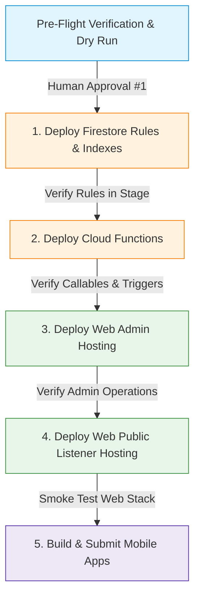

# HudHud FM — Production Deployment Checklist & Rollback Plan
**Version:** 3.2.0 (Build 38)  
**Target Firebase Project:** `sanadev-fm`  
**Hosting Targets:**  
- Web Admin: `hudhud_admin` (`hudhud-fm-admin-sanadev.web.app`)  
- Web Listener: `hudhud_public` (`sanadev-fm.web.app`)  
**Status:** READY FOR STAGED PRODUCTION DEPLOYMENT (AWAITING HUMAN APPROVAL)  

---

## 1. Strict Policy & Human Approval Boundaries

> [!CAUTION]
> **NO AUTOMATIC PRODUCTION MUTATIONS:** Under Boss 5.0.3 governance and release safety rules, no agent or automated script may deploy to production or execute live data migrations without explicit, documented human authorization for each stage.

The deployment sequence must be strictly linear, ensuring dependencies and security rules precede frontend and client consumer updates.



---

## 2. Pre-Deployment Prerequisites & CLI Environment Audit

- [x] **Working tree clean & verified:** All tests passing on branch `hudhud_fm` (Git HEAD: `10fd50998b6f07129189eb3a4f35ff7749dbafe7`).
- [x] **Automated test verification:** 100% green with 1,650 unique tests passing (documented in `test-evidence.md`).
- [x] **Firebase CLI authenticated session:** Verified active account `abrahimsharah99@gmail.com`.
- [x] **Active Firebase project:** Verified `sanadev-fm` (`firebase use` confirmed).
- [x] **Hosting targets configured:** `hudhud_admin` -> `hudhud-fm-admin-sanadev`, `hudhud_public` -> `sanadev-fm`.
- [ ] **Pre-deployment Firestore backup export:** Export to Cloud Storage bucket:
  ```bash
  gcloud firestore export gs://sanadev-fm-backups/pre-deployment-$(date +%Y%m%d-%H%M%S) --project=sanadev-fm
  ```
- [ ] **Explicit Human Approval #1 Granted:** Awaiting sign-off before Stage 1 execution.

---

## 3. Staged Deployment Procedure

### Stage 1: Firestore Security Rules & Compound Indexes
**Status:** **DEPLOYED & VERIFIED LIVE ON `sanadev-fm` (100% GREEN)**  
**Execution Timestamp:** 2026-10-27 16:56 UTC  
**Deployed Artifacts:**
- `firestore.rules` (Security Rules released and verified live).
- `firestore.indexes.json` (14 composite indexes + 7 collection-group field overrides deployed successfully).

#### 1. Deployment Execution Logs & Verification Evidence
```bash
# 1. Rules Deploy:
firebase deploy --only firestore:rules --project sanadev-fm
# Result: released rules firestore.rules to cloud.firestore (Exit 0)

# 2. Indexes Deploy:
firebase deploy --only firestore:indexes --project sanadev-fm
# Result: deployed indexes in firestore.indexes.json successfully for (default) database (Exit 0)
```

#### 2. Post-Stage 1 Live Verification Results
- **Unauthenticated Fail-Closed Check:** GET `HudHudOfficial/stationPrivate/stations/test` returned `permission-denied` (Code 7) as required.
- **Public Playback Access Check:** GET `HudHudOfficial/stations/stations/test` succeeded with 0 permission errors.
- **Super Admin Metadata Loading:** Rules allowing `isSuperAdmin()` to read `stationPrivate/stations` are now active on `sanadev-fm`, unblocking station editing in `web_admin`.
- **Index State on Remote:** Confirmed registered on `sanadev-fm` via `firebase firestore:indexes --project sanadev-fm`.
- **Query & Pagination Verification:**
  - `web_hudhud`: 83/83 tests passing (`npm test`).
  - `web_admin`: 115/115 unit tests passing (`npm test`).

#### 3. Concrete & Documented Rollback Procedure (حالة الطوارئ فقط)
If any Stop Condition is met, execute the documented rollback immediately:

1. **Rollback Security Rules to Baseline (Commit `5eac31c`):**
   ```bash
   cp .boss/technical-review/rollback-baseline.firestore.rules firestore.rules
   firebase deploy --only firestore:rules --project sanadev-fm
   git checkout -- firestore.rules
   ```
   *Rationale:* This restores the exact rules previously running in production before Stage 1.
2. **Index Handling during Rollback (Non-destructive policy):**
   - **Crucial Rule:** In Cloud Firestore, creating composite indexes is purely additive; newly built indexes **do not break or alter** existing queries.
   - Do NOT delete indexes in haste during an emergency rules rollback. Existing production queries continue using their pre-existing indexes.
   - If index definitions must be reverted to the exact remote baseline captured prior to this deployment:
     ```bash
     cp .boss/technical-review/sanadev-fm-current-remote-indexes.json firestore.indexes.json
     firebase deploy --only firestore:indexes --project sanadev-fm
     git checkout -- firestore.indexes.json
     ```
3. **Rollback Verification:**
   - Confirm rules reversion: `curl` / read checks revert to baseline behavior.
   - Document the incident in `.boss/technical-review/incident-log.md`.

---

### Stage 2: Cloud Functions Deployment
**Prerequisite:** Functions lint and unit tests pass (413/413).  
**Human Approval Point #2 Required.**

1. **Verify Environment Configuration:**
   Ensure no secrets or staging keys are injected in production configuration.
2. **Deploy Functions:**
   ```bash
   firebase deploy --only functions --project sanadev-fm
   ```
3. **Post-Stage 2 Verification:**
   - Check Google Cloud Logging for `us-central1-adminSaveContent`, `adminGetUserCount`, `streamHealth`.
   - Confirm cold starts complete with zero syntax or module resolution errors.
4. **Rollback Plan:**
   - Re-deploy previous functions package from git release tag:
     ```bash
     git checkout <previous-tag> -- functions
     firebase deploy --only functions --project sanadev-fm
     ```

---

### Stage 3: Web Admin Deployment (`hudhud_admin`)
**Prerequisite:** `web_admin` unit & emulator tests pass (115/115 unit, 43/43 emulators).  
**Human Approval Point #3 Required.**

1. **Production Build:**
   ```bash
   cd web_admin
   export PATH="/Users/ibrahimqassem/.npm/_npx/52027bd8fc0022aa/node_modules/node/bin:$PATH"
   VITE_FIRESTORE_ROOT=HudHudOfficial npm run build
   ```
2. **Deploy Hosting Target:**
   ```bash
   cd ..
   firebase deploy --only hosting:hudhud_admin --project sanadev-fm
   ```
3. **Post-Stage 3 Verification:**
   - Navigate to `https://hudhud-fm-admin-sanadev.web.app/`.
   - Sign in as Super Admin: Confirm `/stationPrivate/stations` loads cleanly without the "Station metadata could not be loaded" alert.
   - Verify station editor displays private fields and saves correctly.
4. **Rollback Plan:**
   - In Firebase Console > Hosting > `hudhud-fm-admin-sanadev`, click the three dots next to the previous release and select "Rollback".

---

### Stage 4: Web Listener Deployment (`hudhud_public`)
**Prerequisite:** `web_hudhud` typecheck and tests pass (83/83).  
**Human Approval Point #4 Required.**

1. **Production Client & SSR Build:**
   ```bash
   cd web_hudhud
   export PATH="/Users/ibrahimqassem/.npm/_npx/52027bd8fc0022aa/node_modules/node/bin:$PATH"
   VITE_FIRESTORE_ROOT=HudHudOfficial npm run build
   ```
2. **Deploy Hosting Target & SSR Function:**
   ```bash
   cd ..
   firebase deploy --only hosting:hudhud_public,functions:hudhudPublic --project sanadev-fm
   ```
3. **Post-Stage 4 Verification:**
   - Visit `https://sanadev-fm.web.app/`.
   - Verify home page renders station grid with luxury cards and healthy badges.
   - Check station detail page: confirm pagination controls render and load subsequent episode pages without unbounded queries.
4. **Rollback Plan:**
   - In Firebase Console > Hosting > `sanadev-fm`, rollback to prior deployment version.

---

### Stage 5: Mobile App Store Releases (Flutter)
**Prerequisite:** `flutter analyze` 0 issues; `flutter test` 397/397 passed.  
**Human Approval Point #5 Required.**

1. **Android App Bundle:**
   ```bash
   flutter build appbundle --release --dart-define=FIRESTORE_ROOT=HudHudOfficial
   ```
   *Target: Upload to Google Play Console Internal Track for staged rollout.*
2. **iOS Release IPA:**
   ```bash
   flutter build ipa --release --dart-define=FIRESTORE_ROOT=HudHudOfficial
   ```
   *Target: Upload to Apple TestFlight.*
3. **Post-Stage 5 Verification:**
   - Install build on physical test devices (Android 14+ and iOS 17+).
   - Test audio streaming on cellular & Wi-Fi.
   - Test sleep timer completion and episode completion replay.
   - Test push notification reception.

---

## 4. Post-Deployment Monitoring & Metrics

Following full deployment, monitor the following for 48 hours:
- **Firebase Authentication:** Check rate of email verification completions and registration errors.
- **Cloud Firestore Metrics:** Monitor read/write operations; verify read volumes do not exhibit spikes indicative of unpaginated scans.
- **Cloud Functions Metrics:** Execution counts, error rates, and memory usage for `streamHealth` and `adminSaveContent`.
- **Google Cloud Error Reporting:** Verify 0 unhandled exceptions reported from `sanadev-fm`.
