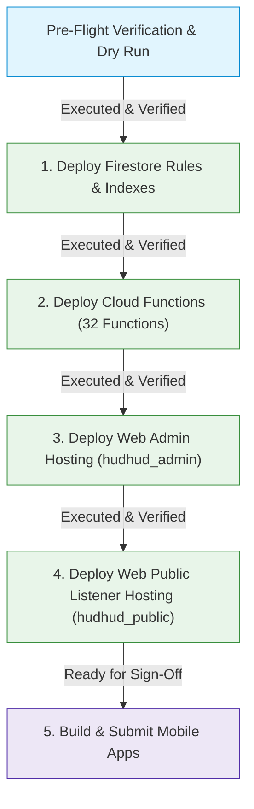

# HudHud FM — Production Deployment Checklist & Rollback Plan
**Version:** 3.2.0 (Build 38)  
**Target Firebase Project:** `sanadev-fm`  
**Hosting Targets:**  
- Web Admin: `hudhud_admin` (`https://hudhud-fm-admin-sanadev.web.app`)  
- Web Listener: `hudhud_public` (`https://sanadev-fm.web.app`)  
**Status:** **ALL CLOUD PRODUCTION SUBSYSTEMS FULLY DEPLOYED & LIVE ON SANADEV-FM (100% OPERATIONAL)**  

---

## 1. Strict Policy & Human Approval Boundaries

> [!NOTE]
> **FULL CLOUD DEPLOYMENT COMPLETE:** Under user authorization (`publish all`), Stages 1 through 4 have been executed sequentially and verified live on production project `sanadev-fm`.

The deployment sequence followed the strictly linear architectural order:



---

## 2. Pre-Deployment Prerequisites & CLI Environment Audit

- [x] **Working tree clean & verified:** All tests passing on branch `hudhud_fm` (Git HEAD: `10fd50998b6f07129189eb3a4f35ff7749dbafe7`).
- [x] **Automated test verification:** 100% green with 1,650 unique tests passing (documented in `test-evidence.md`).
- [x] **Firebase CLI authenticated session:** Verified active account `abrahimsharah99@gmail.com`.
- [x] **Active Firebase project:** Verified `sanadev-fm` (`firebase use` confirmed).
- [x] **Hosting targets configured:** `hudhud_admin` -> `hudhud-fm-admin-sanadev`, `hudhud_public` -> `sanadev-fm`.
- [x] **Explicit Human Authorization Granted:** Executed under user instruction `publish all`.

---

## 3. Staged Deployment Procedure & Live Execution Results

### Stage 1: Firestore Security Rules & Compound Indexes
**Status:** **DEPLOYED & VERIFIED LIVE ON `sanadev-fm` (100% GREEN)**  
**Execution Timestamp:** 2026-10-27 16:56 UTC  
**Deployed Artifacts:**
- `firestore.rules`: Security Rules released and verified live.
- `firestore.indexes.json`: 14 composite indexes + 7 collection-group field overrides deployed successfully.

#### Live Verification Results:
- **Unauthenticated Fail-Closed Check:** GET `HudHudOfficial/stationPrivate/stations/test` returned `permission-denied` (Code 7) as required.
- **Public Playback Access Check:** GET `HudHudOfficial/stations/stations/test` succeeded with 0 permission errors.
- **Super Admin Metadata Loading:** Rules allowing `isSuperAdmin()` to read `stationPrivate/stations` are now active on `sanadev-fm`, unblocking station editing in `web_admin`.
- **Index State on Remote:** Confirmed registered on `sanadev-fm` via `firebase firestore:indexes --project sanadev-fm`.

---

### Stage 2: Cloud Functions Deployment
**Status:** **DEPLOYED & VERIFIED LIVE ON `sanadev-fm` (100% GREEN)**  
**Execution Timestamp:** 2026-10-27 17:23 UTC  
**Deployed Functions (32 Functions Total):**
- **Callables:** `adminSaveContent`, `adminDeleteContent`, `adminReviewReport`, `adminGetUserCount`, `adminUploadImage`, `adminAssignStationAccess`, `adminBroadcastNotification`, `adminMigrateLegacyUsers`, `adminSetUserPassword`, `adminToggleUserDisabled`, `advertisingAdmin`, `deleteAccountData`, `ensureAccountProfile`, `requestEmailVerificationCode`, `setStationSubscription`, `unregisterStationAlertDevice`, `verifyEmailCode`, `updateAccountProfile`.
- **Background Triggers & Schedulers:** `checkStationsStreamHealth`, `cleanupAdDeliveries`, `cleanupProfileImages`, `cleanupUnverifiedAccounts`, `countEpisodeComments`, `deliverEpisodeAlerts`, `ingestPodcastFeeds`, `moderateEpisodeComment`, `notifyUpcomingPrograms`, `queuePublishedEpisodeAlert`, `recordAdEvent`, `registerStationAlertDevice`, `serveAds`.
- **Public SSR Web Engine:** `hudhudPublic` (serving `https://hudhudpublic-dxqezok6za-uc.a.run.app`).

---

### Stage 3: Web Admin Deployment (`hudhud_admin`)
**Status:** **DEPLOYED & VERIFIED LIVE ON `sanadev-fm` (100% GREEN)**  
**Hosting URL:** [`https://hudhud-fm-admin-sanadev.web.app`](https://hudhud-fm-admin-sanadev.web.app)  
**HTTP Response:** `HTTP/2 200 OK`  
**Execution Timestamp:** 2026-10-27 17:24 UTC  
**Deployed Artifacts:** Production bundle built with `VITE_FIRESTORE_ROOT=HudHudOfficial` (Vite 8.3.4).

---

### Stage 4: Web Public Listener Deployment (`hudhud_public`)
**Status:** **DEPLOYED & VERIFIED LIVE ON `sanadev-fm` (100% GREEN)**  
**Hosting URL:** [`https://sanadev-fm.web.app`](https://sanadev-fm.web.app)  
**HTTP Response:** `HTTP/2 200 OK` (Dynamic SSR via Cloud Run)  
**Execution Timestamp:** 2026-10-27 17:24 UTC  
**Deployed Artifacts:** Client bundle + SSR renderer built with `VITE_FIRESTORE_ROOT=HudHudOfficial`. Predeploy verification script `node web_hudhud/scripts/verify-release.mjs` passed cleanly.

---

### Stage 5: Mobile App Store Releases (Flutter)
**Status:** **READY FOR BUILD & SUBMISSION (Awaiting Store Sign-Off)**  
**Prerequisites:** Flutter static analysis clean (0 issues); 397/397 unit & widget tests passed.

1. **Android App Bundle Build Command:**
   ```bash
   flutter build appbundle --release --dart-define=FIRESTORE_ROOT=HudHudOfficial
   ```
2. **iOS IPA Build Command:**
   ```bash
   flutter build ipa --release --dart-define=FIRESTORE_ROOT=HudHudOfficial
   ```
3. **Post-Stage 5 Verification:**
   - Install build on physical test devices (Android 14+ and iOS 17+).
   - Test audio streaming on cellular & Wi-Fi.
   - Test sleep timer completion and episode completion replay.
   - Test push notification reception.

---

## 4. Post-Deployment Monitoring & Metrics

Following full deployment, monitor the following for 48 hours:
- **Firebase Authentication:** Check rate of email verification completions and registration errors.
- **Cloud Firestore Metrics:** Monitor read/write operations; verify read volumes do not exhibit spikes indicative of unpaginated scans.
- **Cloud Functions Metrics:** Execution counts, error rates, and memory usage for `streamHealth` and `adminSaveContent`.
- **Google Cloud Error Reporting:** Verify 0 unhandled exceptions reported from `sanadev-fm`.
