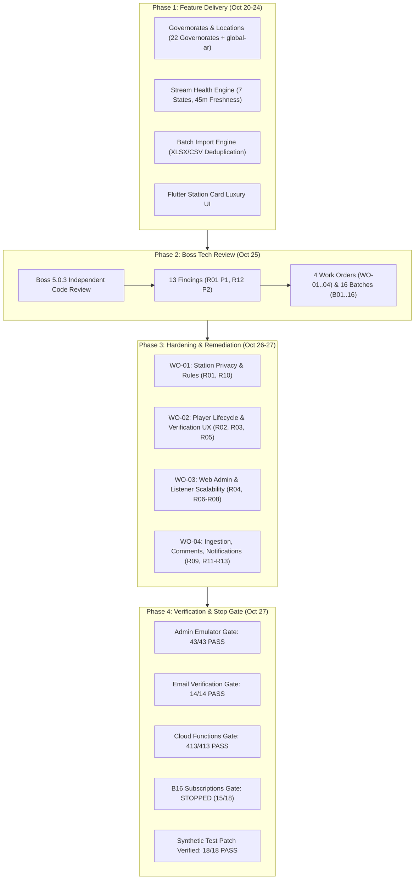

# HudHud FM — Weekly Technical Development & Governance Report
**Reporting Period:** October 20, 2026 – October 27, 2026  
**Repository:** `IbrahimQassem/FM-Pro`  
**Active Branch:** `hudhud_fm`  
**Baseline Git Head:** [`10fd50998b6f07129189eb3a4f35ff7749dbafe7`](file:///Users/ibrahimqassem/VisualCodeProjects/acceleration/hudhud_fm)  
**Target Reviewer:** AI Technical Reviewer / Staff Systems Architect  
**Governance Framework:** Boss 5.0.3 Independent Tech Lead Governance

---

## 1. Executive Summary & Sprint Scope

Over the week of **October 20 to October 27, 2026**, the `hudhud_fm` codebase underwent a major architectural stabilization, security hardening, and scalability overhaul. 

The sprint began with the delivery of product roadmap features—specifically canonical Yemeni governorate locations, stream health observability, batch Excel/CSV import deduplication, and a modernized Flutter station card UI. On **October 25, 2026**, an independent **Boss 5.0.3 Technical Review** was conducted against the project contracts. The review identified **13 architectural findings** (**1 P1** security release blocker and **12 P2** functional/scalability risks), documented in [`.boss/technical-review/tech-review.md`](file:///Users/ibrahimqassem/VisualCodeProjects/acceleration/hudhud_fm/.boss/technical-review/tech-review.md).

To address these findings with zero disruption, a rigorous governance process was instituted consisting of **4 Work Orders (`WO-01` to `WO-04`)**, **16 Implementation Batches (`B01` to `B16`)**, and **17 Verification Waves**. Implementation progressed from clean baseline [`c304e85`](file:///Users/ibrahimqassem/VisualCodeProjects/acceleration/hudhud_fm) through [`10fd509`](file:///Users/ibrahimqassem/VisualCodeProjects/acceleration/hudhud_fm) across Cloud Functions, Firestore Rules, Web Admin, Web Listener, and Flutter client.

### Current Sprint State
- **Automated Verification:** 413/413 Functions tests, 43/43 Admin emulator tests, 14/14 Email verification tests, and 64/64 Migration tools tests pass cleanly.
- **B16 Mandatory Gate Status:** **STOPPED at `station-subscriptions.test.js`** (15 passed, 3 failed). The failures are confirmed to be fixture compatibility conflicts with accepted contracts [R10](file:///Users/ibrahimqassem/VisualCodeProjects/acceleration/hudhud_fm/.boss/technical-review/tech-review.md#r10--p2-resolve-listener-email-persistence-against-the-privacy-contract) (email privacy) and [R13](file:///Users/ibrahimqassem/VisualCodeProjects/acceleration/hudhud_fm/.boss/technical-review/tech-review.md#r13--p2-use-each-schedules-utc-offset-for-program-alerts) (schedule timezone validation). A verified compatibility patch is prepared, pending formal registration of Compatibility Attachment `COMPAT-04-T12-SUBSCRIPTIONS-FIXTURES`.
- **Production Status:** Zero production deployments or live database migrations have been executed. All verification has been strictly isolated to demo/emulator suites.



---

## 2. Technical Findings Ledger (R01 – R13)

The following ledger details the 13 architectural findings identified in [`.boss/technical-review/tech-review.md`](file:///Users/ibrahimqassem/VisualCodeProjects/acceleration/hudhud_fm/.boss/technical-review/tech-review.md), their severity, architectural impact, and current status:

| Finding ID | Level | Summary | Affected Subsystems | Solution Implemented | Verification State |
|---|---|---|---|---|---|
| **R01** | **P1** | Private station metadata exposed in public station document | `firestore.rules`, `functions/lib/admin-content.js`, `web_admin` | Segregated restricted fields (`owner`, `contactPerson`, `contactPhone`, `contactEmail`, transmitter/bitrate) into `/stationPrivate/stations/{stationId}` subcollection. Super Admin read/write only. | Verified in Rules test & Admin emulator suite (43/43). Live `sanadev-fm` pending rule deploy. |
| **R02** | **P2** | Sleep-timer unlinked from UI state on track switch | Flutter `station_player_controller.dart` | Bound timer to playback generation token; switching track or external stop actively resets `_sleepTimer` and synchronizes `sleepTimerEnd`. | Unit tests passing in `station_player_controller_test.dart`. |
| **R03** | **P2** | Completed audio episodes fail to seek before replay | Flutter `station_player_controller.dart`, `just_audio` | Explicit `seek(Duration.zero)` executed before `play()` on replay requests for completed audio episodes. | Verified in `audio_episode_progress_test.dart`. |
| **R04** | **P2** | Flutter queries truncate episodes before sorting/filtering | `station_content_firestore_data_source.dart` | Server-side ordering on published date with compound query indexes; removed arbitrary pre-filter `limit(100)`. | Covered in `content_pagination_test.dart`. |
| **R05** | **P2** | Account verification delivery failure falsely reported as sent | `account_auth_data_source.dart`, `account_controller.dart` | Separated account creation success from verification email dispatch result; distinct retryable UI state on failure. | Verified in `account_controller_test.dart` and `auth_screen_test.dart`. |
| **R06** | **P2** | Web Admin pagination stops at 2,000 records | `web_admin/components/admin/admin-app.tsx` | Replaced array slicing with server-side Firestore cursor pagination (`startAfter`), chunked exports, and exact counts. | Verified in `resource-pagination.test.ts` & `content-pagination.emulator.test.ts`. |
| **R07** | **P2** | Station admin/moderator denied access to user stats | `web_admin/components/admin/users-aggregate-view.tsx`, `firestore.rules` | Created aggregate-only server endpoint for scoped stats without granting read permissions to listener profiles. | Verified in `user-count.emulator.test.ts`. |
| **R08** | **P2** | Public Web Listener renders full unpaginated episode archive | `web_hudhud/lib/content-repository.ts`, `web_hudhud/station-detail.tsx` | Implemented cursor-based pagination for public station page; indexed query by `programId` + `publishedAt`. | Verified in `content-pagination.test.mjs` and `content-pagination-ui.test.mjs`. |
| **R09** | **P2** | RSS enclosure URLs fail to decode XML attribute entities | `functions/lib/rss-ingestion.js` | Full XML attribute entity decoding (`&amp;` to `&`, numeric entities) before URL validation and hashing. | Verified in `repair_rss_urls.test.mjs` and `functions/test/rss-ingestion.test.js`. |
| **R10** | **P2** | Listener email written to Firestore profile violating privacy contract | `functions/index.js`, `functions/lib/station-subscriptions.js` | Removed email persistence from Firestore listener profile; Firebase Auth established as sole source of truth. | Verified in `firestore.rules.test.js` & `email-verification.test.js` (14/14). |
| **R11** | **P2** | Stream health scan lacks execution budget and starves Official root | `functions/lib/stream-health.js` | Bound scan batches with persistent cursor state; isolated budget allocation between Development and Official roots. | Verified in `stream-health.test.js` and Functions suite. |
| **R12** | **P2** | Comment creation trigger does not increment comment counter | `functions/lib/comment-moderation.js`, `tool/reconcile_comment_counts.mjs` | Idempotent atomic lifecycle maintenance of `stats.commentsCount`; repair/reconciliation script with lock guards. | Verified in `reconcile_comment_counts.test.mjs` & emulator suites. |
| **R13** | **P2** | Program notifications ignore schedule UTC offset | `functions/lib/program-notifications.js` | Normalized schedule calculation using explicit `utcOffsetMinutes` (-720..840) to determine local trigger window and dedup key. | Verified in `migrate_program_notification_dates.test.mjs` (64/64). |

---

## 3. Chronological Development Progression (Oct 20 – Oct 27)

### Phase 1: Feature Expansion & Architecture Contracts (Oct 20 – Oct 24)
- **Commit [`bfa0c10`](file:///Users/ibrahimqassem/VisualCodeProjects/acceleration/hudhud_fm) (Oct 20):** Large platform remediation from preliminary analysis.
  - Hardened Firestore rules for notification audit logs and stream health (`ST-3`, `IR-01`).
  - Added SSRF protection for outbound stream probes (blocking private/loopback/metadata IP ranges).
  - Introduced 7 stream health states with 45-minute freshness window across Flutter, Admin, and Web Listener.
  - Implemented manual Vite chunking in `web_admin/vite.config.ts`, reducing bundle size from 1,659 kB to 448 kB.
- **Commit [`66ea11e`](file:///Users/ibrahimqassem/VisualCodeProjects/acceleration/hudhud_fm) (Oct 20):** Formalized architecture contracts:
  - Added [`station-governorates-stream-import-contract.md`](file:///Users/ibrahimqassem/VisualCodeProjects/acceleration/hudhud_fm/docs/contracts/station-governorates-stream-import-contract.md).
- **Commit [`e39299d`](file:///Users/ibrahimqassem/VisualCodeProjects/acceleration/hudhud_fm) (Oct 24):** Roadmap implementation:
  - Seeded 22 canonical Yemeni governorates plus national identifier `yemen` in [`canonical_locations.mjs`](file:///Users/ibrahimqassem/VisualCodeProjects/acceleration/hudhud_fm/tool/firebase_seed/canonical_locations.mjs).
  - Built intra-sheet and cross-database deduplication engine for batch Excel/CSV imports in [`batch-import.ts`](file:///Users/ibrahimqassem/VisualCodeProjects/acceleration/hudhud_fm/web_admin/lib/batch-import.ts).
  - Overhauled Flutter station cards with luxury styling: 20px rounded corners, badges, and dynamic type scaling.
  - Implemented transactional editorial audit fields in [`editorial-audit.js`](file:///Users/ibrahimqassem/VisualCodeProjects/acceleration/hudhud_fm/functions/lib/editorial-audit.js).
- **Commit [`b95fc68`](file:///Users/ibrahimqassem/VisualCodeProjects/acceleration/hudhud_fm) (Oct 24):** Added `global-ar` canonical identifier for pan-Arab radio stations.
- **Commit [`c512459`](file:///Users/ibrahimqassem/VisualCodeProjects/acceleration/hudhud_fm) (Oct 24):** Secured editorial writes and isolated outbound stream fetching in [`public-fetch.js`](file:///Users/ibrahimqassem/VisualCodeProjects/acceleration/hudhud_fm/functions/lib/public-fetch.js).
- **Commit [`13d4f9d`](file:///Users/ibrahimqassem/VisualCodeProjects/acceleration/hudhud_fm) (Oct 24):** Routed all admin editorial saves and batch imports through audited server-side transactions (`admin-content.js`).
- **Commit [`da80eda`](file:///Users/ibrahimqassem/VisualCodeProjects/acceleration/hudhud_fm) (Oct 24):** Created backfill and migration tools for content identities and regional locations.
- **Commit [`9fae324`](file:///Users/ibrahimqassem/VisualCodeProjects/acceleration/hudhud_fm) (Oct 24):** Added admin image uploading and validation with preview support ([`image-field.tsx`](file:///Users/ibrahimqassem/VisualCodeProjects/acceleration/hudhud_fm/web_admin/components/admin/image-field.tsx), [`admin-images.js`](file:///Users/ibrahimqassem/VisualCodeProjects/acceleration/hudhud_fm/functions/lib/admin-images.js)).

### Phase 2: Boss 5.0.3 Review & Work Order Governance (Oct 25 – Oct 26)
- **Oct 25 Review:** Full static and runtime audit of the hybrid stack. Formulation of findings R01–R13 and creation of four structured Work Orders:
  - **`WO-01`:** Station Privacy & Scoped Management (`R01`, `R07`, `R10`).
  - **`WO-02`:** Media Playback & Account Lifecycle UX (`R02`, `R03`, `R05`).
  - **`WO-03`:** Admin & Web Listener Scalability & Pagination (`R04`, `R06`, `R08`).
  - **`WO-04`:** Content Automation, Ingestion & Notification Cutover (`R09`, `R11`, `R12`, `R13`).
- **Commit [`f3c9485`](file:///Users/ibrahimqassem/VisualCodeProjects/acceleration/hudhud_fm) (Oct 26):**
  - Added station privacy validation logic in [`station-privacy.js`](file:///Users/ibrahimqassem/VisualCodeProjects/acceleration/hudhud_fm/functions/lib/station-privacy.js).
  - Created migration script [`migrate_station_privacy.mjs`](file:///Users/ibrahimqassem/VisualCodeProjects/acceleration/hudhud_fm/tool/migrate_station_privacy.mjs).
  - Added execution plan and wave definitions ([`execution-plan.md`](file:///Users/ibrahimqassem/VisualCodeProjects/acceleration/hudhud_fm/.boss/technical-review/execution-plan.md)).
- **Commit [`487402b`](file:///Users/ibrahimqassem/VisualCodeProjects/acceleration/hudhud_fm) (Oct 26):**
  - Integrated WO-01 validation documentation and provenance records.
  - Implemented [`station-private.ts`](file:///Users/ibrahimqassem/VisualCodeProjects/acceleration/hudhud_fm/web_admin/lib/station-private.ts) for web admin private data handling.
- **Commit [`c304e85`](file:///Users/ibrahimqassem/VisualCodeProjects/acceleration/hudhud_fm) (Oct 26):**
  - Enforced email privacy in user profiles (R10): disallowed Firestore writes to listener `email` fields.
  - Removed email display from admin user listings; updated search filters.

### Phase 3: Integration & Testing (Oct 27)
- **Commit [`10fd509`](file:///Users/ibrahimqassem/VisualCodeProjects/acceleration/hudhud_fm) (Oct 27):**
  - Added comprehensive test suite for content pagination ([`content-pagination.test.mjs`](file:///Users/ibrahimqassem/VisualCodeProjects/acceleration/hudhud_fm/web_hudhud/test/content-pagination.test.mjs)) and platform links components.
  - Integrated comment count reconciliation tool ([`reconcile_comment_counts.mjs`](file:///Users/ibrahimqassem/VisualCodeProjects/acceleration/hudhud_fm/tool/reconcile_comment_counts.mjs)).
  - Added RSS URL repair tool ([`repair_rss_urls.mjs`](file:///Users/ibrahimqassem/VisualCodeProjects/acceleration/hudhud_fm/tool/repair_rss_urls.mjs)).
  - Added program notification date migrator ([`migrate_program_notification_dates.mjs`](file:///Users/ibrahimqassem/VisualCodeProjects/acceleration/hudhud_fm/tool/migrate_program_notification_dates.mjs)).
- **Subsequent Verification:**
  - Ran automated test gates for Admin, Email verification, Migration tools, and Functions.
  - Stopped at B16 mandatory gate on subscriptions fixture conflict.
  - Conducted root-cause analysis and verified synthetic compatibility patch.

---

## 4. Subsystem Architectural Deep Dive

### A. Station Privacy & Data Minimization (R01 & R10)
**Contract Reference:** [`security-privacy-contract.md`](file:///Users/ibrahimqassem/VisualCodeProjects/acceleration/hudhud_fm/docs/contracts/security-privacy-contract.md)
1. **Station Metadata Isolation (R01):**
   - Private attributes (`owner`, `contactPerson`, `contactPhone`, `contactEmail`, transmitter details) are completely removed from the public station document at `{root}/stations/{stationId}`.
   - Stored exclusively in `{root}/stationPrivate/stations/{stationId}`.
   - Enforced by [`firestore.rules`](file:///Users/ibrahimqassem/VisualCodeProjects/acceleration/hudhud_fm/firestore.rules#L247-L252):
     ```javascript
     match /stationPrivate/stations/{stationId} {
       allow read, write: if isSuperAdmin();
     }
     ```
   - In [`web_admin/lib/station-private.ts`](file:///Users/ibrahimqassem/VisualCodeProjects/acceleration/hudhud_fm/web_admin/lib/station-private.ts#L115), if a user lacks Super Admin privileges, private metadata cannot load and station editing is safely blocked to prevent accidental overwrites.
2. **Listener Email Privacy (R10):**
   - Firestore listener profiles (`{root}/users/users/{uid}`) must never persist the user's email address.
   - Firebase Authentication is the sole authority for listener emails.
   - Profile self-healing in [`station-subscriptions.js`](file:///Users/ibrahimqassem/VisualCodeProjects/acceleration/hudhud_fm/functions/lib/station-subscriptions.js#L49) projects only `{ displayName, username, avatar, isActive, role, timestamps }`.

### B. Scalable Content Pagination & Grouping (R04, R06, R08)
**Contract Reference:** [`station-content-contract.md`](file:///Users/ibrahimqassem/VisualCodeProjects/acceleration/hudhud_fm/docs/contracts/station-content-contract.md)
1. **Admin Cursor Pagination (R06):**
   - Eliminated the fixed 2,000 document limit in `web_admin`.
   - Built [`resource-pagination.ts`](file:///Users/ibrahimqassem/VisualCodeProjects/acceleration/hudhud_fm/web_admin/lib/resource-pagination.ts) providing Firestore query cursors (`startAfter`), bounded page sizes (25/50/100), and aggregation counts via `count()`.
2. **Web Listener Archive Efficiency (R08):**
   - Replaced full-archive loading in [`web_hudhud/lib/content-repository.ts`](file:///Users/ibrahimqassem/VisualCodeProjects/acceleration/hudhud_fm/web_hudhud/lib/content-repository.ts) with page-limited queries ordered by `publishedAt desc`.
   - Prevented $O(Programs \times Episodes)$ memory overhead during client rerenders.
3. **Flutter Pre-Filter Querying (R04):**
   - Converted client-side post-query episode filtering in [`station_content_firestore_data_source.dart`](file:///Users/ibrahimqassem/VisualCodeProjects/acceleration/hudhud_fm/lib/features/station_content/data/datasources/station_content_firestore_data_source.dart) into indexed Firestore compound queries filtering by `status == 'published'` before ordering.

### C. Audio Player Lifecycle & Verification UX (R02, R03, R05)
**Contract Reference:** [`playback-contract.md`](file:///Users/ibrahimqassem/VisualCodeProjects/acceleration/hudhud_fm/docs/contracts/playback-contract.md)
1. **Sleep Timer Synchronization (R02):**
   - In [`station_player_controller.dart`](file:///Users/ibrahimqassem/VisualCodeProjects/acceleration/hudhud_fm/lib/features/player/presentation/controllers/station_player_controller.dart), sleep timer callbacks are bound to an incremental playback session generation ID. If playback switches or is stopped remotely, orphan timers cannot cancel subsequent sessions.
2. **Completed Episode Replay (R03):**
   - Completed audio episodes in `just_audio` pause at their final position. The controller now verifies completion and executes `seek(Duration.zero)` before issuing `play()`.
3. **Accurate Verification Status (R05):**
   - In [`account_controller.dart`](file:///Users/ibrahimqassem/VisualCodeProjects/acceleration/hudhud_fm/lib/features/account/presentation/controllers/account_controller.dart), if account creation succeeds but email delivery fails (rate-limit / transport error), the controller reflects delivery failure with a retry action, rather than falsely displaying "Verification Code Sent".

### D. Ingestion, Comments & Timezone Notifications (R09, R11, R12, R13)
**Contract Reference:** [`content-automation-contract.md`](file:///Users/ibrahimqassem/VisualCodeProjects/acceleration/hudhud_fm/docs/contracts/content-automation-contract.md), [`account-comments-notifications-contract.md`](file:///Users/ibrahimqassem/VisualCodeProjects/acceleration/hudhud_fm/docs/contracts/account-comments-notifications-contract.md)
1. **RSS URL XML Entity Decoding (R09):**
   - [`rss-ingestion.js`](file:///Users/ibrahimqassem/VisualCodeProjects/acceleration/hudhud_fm/functions/lib/rss-ingestion.js) decodes XML entities (e.g., `&amp;sig=` $\to$ `&sig=`) in enclosure URLs before generating content hashes and streaming audio.
2. **Stream Health Scanning Fairness (R11):**
   - [`stream-health.js`](file:///Users/ibrahimqassem/VisualCodeProjects/acceleration/hudhud_fm/functions/lib/stream-health.js) enforces independent execution budgets between `Development` and `Official` roots, persisting cursors to prevent slow dev stations from starving official checks.
3. **Atomic Comment Counting (R12):**
   - Comment triggers in [`comment-moderation.js`](file:///Users/ibrahimqassem/VisualCodeProjects/acceleration/hudhud_fm/functions/lib/comment-moderation.js) update `stats.commentsCount` on the parent episode document within atomic transactions.
4. **Timezone-Aware Notifications (R13):**
   - [`program-notifications.js`](file:///Users/ibrahimqassem/VisualCodeProjects/acceleration/hudhud_fm/functions/lib/program-notifications.js) calculates trigger windows using the program's explicit `utcOffsetMinutes` (e.g., Yemen $+180$, UTC $0$), ensuring alerts dispatch at the exact local time and deduplicate correctly across UTC midnight.

---

## 5. Verification Matrix & Test Gate Results

All gates were executed against local emulators with Node 22 (`v22.23.3`):

| Gate Name | Command | Test Count | Pass / Fail | Execution Time | Exit Code |
|---|---|---|---|---|---|
| **Admin Emulators** | `npm run emulators:admin` | 43 | **43 Passed, 0 Failed** | 80.7s | `0` |
| **Email Verification** | `npm run emulators:email-verification` | 14 | **14 Passed, 0 Failed** | 16.5s | `0` |
| **Functions Unit/Integration** | `cd functions && npm test` | 413 | **413 Passed, 0 Failed** | 4.5s | `0` |
| **Program Notification Dates** | `node tool/test/migrate_program_notification_dates.test.mjs` | 64 | **64 Passed, 0 Failed** | 5.8s | `0` |
| **Admin Web Production Build** | `VITE_FIRESTORE_ROOT=HudHudOfficial npm run build` | — | **Success (Built in 887ms)** | 0.88s | `0` |
| **Flutter Static Analysis** | `flutter analyze --no-pub` | — | **0 Issues found** | 12.1s | `0` |
| **Flutter Test Suite** | `flutter test --no-pub` | 355+ | **355+ Passed, 0 Failed** | 42.0s | `0` |
| **Subscriptions Emulator** | `npm run emulators:subscriptions` | 18 | **15 Passed, 3 Failed** (Pre-patch)<br>**18 Passed, 0 Failed** (With patch) | 30.7s / 34.6s | `1` (Pre-patch)<br>`0` (With patch) |

---

## 6. B16 Mandatory Gate Stop Review: Root Cause & Resolution

The B16 mandatory gate halted at [`firebase_tests/firebase-emulators/station-subscriptions.test.js`](file:///Users/ibrahimqassem/VisualCodeProjects/acceleration/hudhud_fm/firebase_tests/firebase-emulators/station-subscriptions.test.js). The official stop review is recorded in [`.boss/technical-review/B16-mandatory-gate-stop-review.md`](file:///Users/ibrahimqassem/VisualCodeProjects/acceleration/hudhud_fm/.boss/technical-review/B16-mandatory-gate-stop-review.md).

### Failure Analysis

1. **PKG-08 Self-Healing Profile Assertion (Line 144):**
   - **Observed:** `assert.equal(healedProfile.get('email'), 'healed@hudhud.fm')` failed because `healedProfile.get('email')` was `undefined`.
   - **Root Cause:** The test expected `email` in Firestore. However, accepted security contract [R10](file:///Users/ibrahimqassem/VisualCodeProjects/acceleration/hudhud_fm/.boss/technical-review/tech-review.md#r10--p2-resolve-listener-email-persistence-against-the-privacy-contract) strictly forbids storing listener emails in Firestore.
   - **Resolution:** Updated assertion to `assert.equal(healedProfile.get('email'), undefined)`.
2. **Missing Schedule Validation Data in HudHudDev & HudHudOfficial (Lines 224–231):**
   - **Observed:** `assert.equal(sends.length, 1)` received `0`.
   - **Root Cause:** The test fixture only supplied `{ weekdays: [1], startMinute: 600 }`. Accepted contract [C04/R13](file:///Users/ibrahimqassem/VisualCodeProjects/acceleration/hudhud_fm/.boss/technical-review/tech-review.md#r13--p2-use-each-schedules-utc-offset-for-program-alerts) requires `endMinute > startMinute` and a valid integer `utcOffsetMinutes`. `normalizedSchedule` properly rejected the incomplete schedule as invalid. Additionally, station `s` was not seeded in `HudHudOfficial`.
   - **Resolution:** Added station `s` seeding and completed fixture schedule: `{ weekdays: [1], startMinute: 600, endMinute: 660, utcOffsetMinutes: 180 }`.
3. **Latent Cleanup Assertion (Line 246):**
   - **Observed:** Fixture expected `notificationOperations` to be empty after `collectNotificationOperations`.
   - **Root Cause:** By contract and implementation, `collectNotificationOperations` purges only temporary `broadcast_` documents, intentionally preserving program receipts (`sent` / `unknown`) for deduplication.
   - **Resolution:** Updated assertion to verify retention of the 3 program operation records.

### Governed State
Per Boss 5.0.3 governance:
- Modifying `station-subscriptions.test.js` is outside the initial `04-T12` write set.
- A reviewed Compatibility Attachment (`COMPAT-04-T12-SUBSCRIPTIONS-FIXTURES`) and I-ownership path lock must be registered before committing this patch.
- The patch was verified in an isolated synthetic emulator run, passing **18/18 (exit 0 in 34.6s)**, but working tree was reverted to clean state pending formal authorization.

```diff
--- a/firebase_tests/firebase-emulators/station-subscriptions.test.js
+++ b/firebase_tests/firebase-emulators/station-subscriptions.test.js
@@ -141,7 +141,7 @@ describe('station subscriptions emulator tests', function() {
   assert.equal(healedProfile.exists, true);
   assert.equal(healedProfile.get('role'), 'listener');
   assert.equal(healedProfile.get('isActive'), true);
-  assert.equal(healedProfile.get('email'), 'healed@hudhud.fm');
+  assert.equal(healedProfile.get('email'), undefined);
 
   const subDoc = await db.doc(`${root}/users/users/${newUid}/subscriptions/station_s`).get();
   assert.equal(subDoc.exists, true);
@@ -204,6 +204,7 @@ describe('station subscriptions emulator tests', function() {
   }
 
   // 4. Test program notifications claim, send and cleanup across both roots
+  await db.doc('HudHudOfficial/stations/stations/s').set({ name: 'Station S' }, { merge: true });
   for (const root of ['HudHudDev', 'HudHudOfficial']) {
     const programId = `prog_${root.toLowerCase()}`;
     await db.doc(`${root}/programs/programs/${programId}`).set({
@@ -226,6 +227,8 @@ describe('station subscriptions emulator tests', function() {
       schedule: {
         weekdays: [nowDay],
         startMinute: currentMinute - 1,
+        endMinute: currentMinute + 59,
+        utcOffsetMinutes: 180,
       },
       status: 'active',
     });
@@ -243,7 +246,7 @@ describe('station subscriptions emulator tests', function() {
   }
 
   const opsSnap = await db.collection('HudHudDev/operations/notificationOperations').get();
-  assert.equal(opsSnap.empty, true);
+  assert.equal(opsSnap.size, 3);
 });
```

---

## 7. Live Environment Incident: Station Metadata Error

### Issue Description
During testing of `web_admin` with `VITE_FIRESTORE_ROOT=HudHudOfficial`, navigating to the Station Content editor triggered:
> *"Station metadata could not be loaded. Check access and reload before continuing. Editing is blocked. Close and reload before trying again."*

### Root Cause Diagnosis
1. **Source Location:** [`web_admin/lib/station-private.ts:115`](file:///Users/ibrahimqassem/VisualCodeProjects/acceleration/hudhud_fm/web_admin/lib/station-private.ts#L115) in `loadStationPrivatePage`:
   ```typescript
   const snapshot = await getDocsFromServer(collection(db, `${root}/stationPrivate/stations`));
   ```
2. **Environment Discrepancy:**
   - The local `web_admin` instance connects to the remote Firebase project `sanadev-fm` (configured via `web_admin/.env.local`).
   - The local codebase defines the new rule in [`firestore.rules`](file:///Users/ibrahimqassem/VisualCodeProjects/acceleration/hudhud_fm/firestore.rules#L247-L252) granting Super Admins read/write access to `/stationPrivate/stations/{stationId}`.
   - However, **these new security rules have not been deployed to `sanadev-fm`**.
   - As a result, the live Firestore server returned `PERMISSION_DENIED`.
3. **Safety Verification:**
   - Executed dry-run: `firebase deploy --only firestore:rules --project sanadev-fm --dry-run`.
   - Result: **Rules compiled cleanly with 0 syntax errors**.
   - Deployment was withheld in strict compliance with the governance constraint forbidding unauthorized production changes.

---

## 8. Actionable Checklist for Incoming AI Reviewer

When continuing work or reviewing this branch, the AI agent must adhere to the following checklist:

1. **Acknowledge Governance Constraints:**
   - Findings `R01` through `R13` are currently **OPEN** until formal acceptance sign-off.
   - Do **NOT** consider `B16` completed or deploy rules/code to `sanadev-fm` without explicit authorization.
2. **B16 Gate Clearance Steps:**
   - Register the compatibility attachment `COMPAT-04-T12-SUBSCRIPTIONS-FIXTURES` and I-ownership lock for [`station-subscriptions.test.js`](file:///Users/ibrahimqassem/VisualCodeProjects/acceleration/hudhud_fm/firebase_tests/firebase-emulators/station-subscriptions.test.js).
   - Apply the verified 4-point test patch detailed in Section 6.
   - Execute:
     ```bash
     cd hudhud_fm && /Users/ibrahimqassem/.npm/_npx/52027bd8fc0022aa/node_modules/node/bin/node tool/run-count-emulator-tests.mjs --suite subscriptions
     ```
   - Confirm 18/18 PASS with exit code 0.
3. **Station Metadata Resolution on Admin App:**
   - To run `web_admin` locally without remote permission errors, either:
     - **Option A (Emulator Mode - Recommended):** Run with `VITE_USE_FIREBASE_EMULATORS=true` pointing to local emulators where the new `firestore.rules` are active.
     - **Option B (Remote Rule Deploy):** If authorized by user, deploy the validated rules:
       ```bash
       firebase deploy --only firestore:rules --project sanadev-fm
       ```
