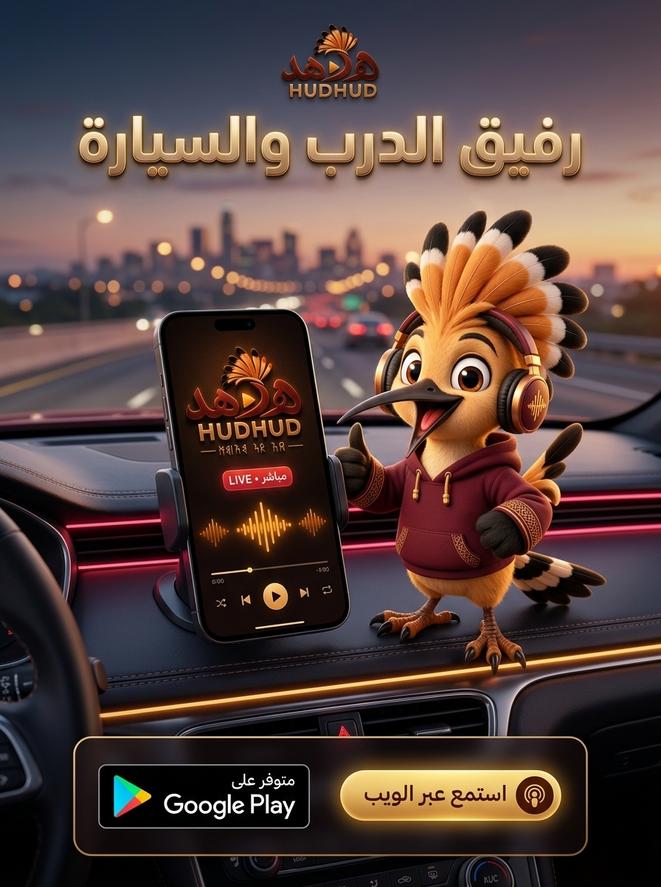

# حملة رفيق الدرب والسيارة — Campaign 01: The Car & Commute Companion
> **وثيقة الحملة التسويقية الرسمية لإعلانات وسائل التواصل الاجتماعي (Social Media Campaign Package)**  
> **الإصدار المستهدف:** HudHud FM v3.1.0+ / Web Player Live  
> **تاريخ الإعداد:** 14 أكتوبر 2026  
> **حالة الحملة:** جاهزة للنشر الفوري (Production Ready)

---

## 1. الفكرة العامة والهدف (Campaign Vision & Objective)

### الفكرة الرئيسية
تحويل تطبيق وموقع «هدهد إف إم» إلى الرفيق الأول والأساسي لكل سائق ومسافر وراكب في اليمن وخارجها. نركز على اللحظة اليومية الأكثر تكراراً: **زحمة السير، مشوار العمل الصباحي، والسفر الطويل بين المدن**.

### الرسالة المحورية
> **«مهما طال الطريق أو اشتدت الزحمة.. صوت اليمن معك، نقي وبدون تقطيع!»**

### الأهداف التسويقية (Core KPIs)
1. **دفع تنزيلات تطبيق أندرويد عبر Google Play:** إبراز مزايا استقرار البث، العمل في خلفية الشاشة، والتحكم عبر شاشة القفل وبلوتوث السيارة.
2. **زيادة زيارات والاستماع الفوري عبر منصة الويب (Web Player):** إزالة أي عائق أمام الاستماع عبر رابط فوري بضغطة زر واحدة (Zero Friction).
3. **رفع التفاعل والمشاركات العضوية:** استخدام نبرة دافئة، ودودة، ومحفزة تلامس واقع السائقين ومحبي الإذاعات.

---

## 2. المعاينة البصرية الرسمية (Official Campaign Visual)

  

*الشكل 1: بوستر الحملة الرسمي (4:5) — تصميم ثلاثي الأبعاد فاخر (Dark Glassmorphism) يجمع تميمة الهدهد الرسمية، قمرة القيادة، وشاشة الهاتف المباشرة مع التحويل المزدوج (Google Play + استمع عبر الويب).*

---

## 3. استراتيجية الإجراء المزدوج (Dual-CTA Architecture)

تم تصميم الحملة بآلية تحويل مزدوجة (Dual Call-to-Action) تلبي سلوك نوعين من المستخدمين:

| المسار (Channel) | الإجراء (Action) | الدافع التسويقي (Value Proposition) | الرابط المباشر (Direct Link) |
|---|---|---|---|
| **المسار الأول: التطبيق الذكي** | 📲 **تثبيت من Google Play** | استماع مستمر بالخلفية، بدون استهلاك زائد للبيانات، تحكم سلس عبر شاشة القفل وبلوتوث السيارة. | [تحميل تطبيق هدهد FM](https://play.google.com/store/apps/details?id=com.sana.dev.fm) |
| **المسار الثاني: منصة الويب** | 🌐 **استمع فوراً عبر المتصفح** | بضغطة زر واحدة بدون تثبيت، يعمل فوراً على أي متصفح، كمبيوتر، أو شاشة سيارة تدعم الويب. | [مشغل الويب المباشر](https://sanadev-fm.web.app) |

---

## 3. محتويات المجلد (Package Contents)

1. [`POST_AR.md`](./POST_AR.md) — نصوص النشر باللغة العربية مخصصة لمنصات: إكس (Twitter)، فيسبوك، إنستغرام، ثريدز، واتساب وتيليجرام، وسيناريو ريلز/تيك توك قصير (15 ثانية).
2. [`POST_EN.md`](./POST_EN.md) — نصوص النشر باللغة الإنجليزية لمخاطبة المغتربين والجمهور الدولي.
3. [`POSTER_SPEC.md`](./POSTER_SPEC.md) — الدليل الفني لتصميم البوستر والمحتوى البصري (UI/UX Graphic Specification) بمقاسات 4:5 و 1:1 و 9:16 مع توزيع العناصر والطبقات.
4. [`PROMPTS.md`](./PROMPTS.md) — أوامر التوليد الذكي للصور والبوسترات الموجهة لنظام `hudhud-media` وفق هوية البراند الرسمية.
5. [`media/`](./media/) — مجلد الأصول البصرية المنتجة والبوسترات الجاهزة للنشر.

---

## 4. الجمهور المستهدف (Target Audience & Personas)

1. **السائقون وأصحاب السيارات (Daily Commuters):**
   - المعاناة: تقطع ترددات FM العادية أثناء التنقل وخروج السيارة عن نطاق البث، أو الملل من الزحام.
   - الحل: هدهد FM يوفر كافة إذاعات صنعاء، عدن، تعز، حضرموت، ومأرب بصوت كريستالي موصول ببلوتوث السيارة.
2. **المسافرون بين المحافظات (Intercity Travelers):**
   - المعاناة: فقدان الإشارة الإذاعية بمجرد الابتعاد عن المدينة.
   - الحل: بث رقمي خفيف ومستقر يعمل حتى على شبكات 3G/4G المحدودة.
3. **أصحاب المشاوير السريعة وعشاق البساطة:**
   - المعاناة: عدم الرغبة في تنزيل تطبيقات جديدة أو امتلاء ذاكرة الهاتف.
   - الحل: مشغل الويب الفوري بضغطة زر واحدة.

---

## 5. مصفوفة النشر والتوزيع (Distribution Channels)

* **منصة إكس (Twitter/X):** تركيز على التغريدة السريعة، إبراز البلوتوث ومشوار الصباح، مع وسم `#هدهد_إف_إم` وروابط مختصرة.
* **فيسبوك (Facebook):** منشور قصصي تفاعلي يسأل الجمهور عن إذاعتهم المفضلة في السيارة مع إدراج زري CTA واضحيْن.
* **إنستغرام (Instagram & Threads):** بوستر 4:5 عالي الجودة Dark Glassmorphism، ورابط مباشر في البايو أو ملصق Link في الستوري.
* **مجموعات وقنوات واتساب وتيليجرام:** رسالة بث أنيقة بأسلوب النقاط السريعة ومحفز استماع مباشر.
