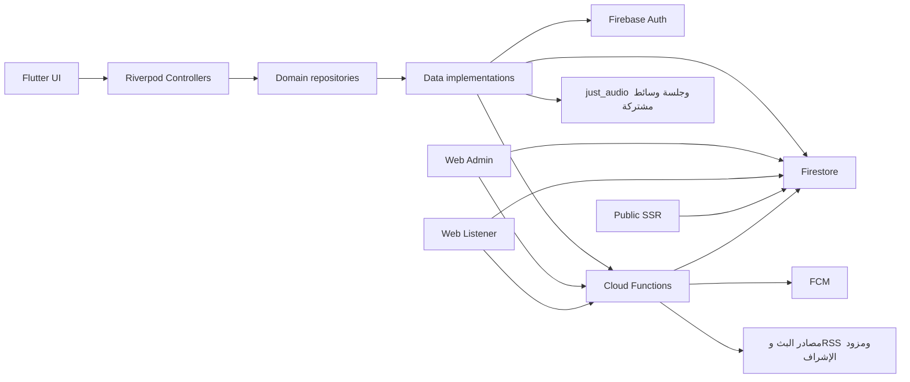

# تحليل مستقل لمنصة هدهد إف إم وخطة معالجة الدين التقني وتحسين موثوقية البث

تاريخ المراجعة: **19 أكتوبر 2026**. الحالة: **تحليل محلي وخطة مقترحة؛ ليست موافقة إطلاق**.

## 1. الملخص التنفيذي

المشروع يضم تطبيق Flutter ولوحة إدارة وموقع مستمع وخلفية Firebase، وفيه وظائف فعلية تتجاوز تشغيل المحطات: حسابات وتوثيق بريد، برامج وحلقات وجداول، تعليقات وبلاغات وحظر، متابعة محطات وتنبيهات حلقات، حملات إعلانية، استيراد جداول وRSS، وفحص دوري للبث. لذلك لا تحتاج الخطة إلى إعادة بناء هذه الوظائف من الصفر؛ تحتاج إغلاق فجوات الصلاحيات وتكامل الرحلات وتوحيد العقود.

الأولوية الأعلى هي حماية سجل الإرسال وتضييق صلاحيات مدير المحطة، وفصل تغيير كلمة المرور عن توثيق البريد والتفعيل، وإصلاح مسار التعليق والعداد والإشراف. اختبارات المشروع الحالية تنجح في معظمها، لكنها لا تغطي هذه الضمانات بالكامل: أُعيد إنتاج فجوات الصلاحيات على المحاكي، وفشل إخفاء تعليق جديد في الجذرين، إضافة إلى أربع حالات فشل بفحوص معزولة تعتمد mocks.

طلب المستخدم تمييز المحطات التي توقف بثها. توجد بداية لهذا المسار في الخلفية، لكن نموذج المحطة والواجهة لا يعرضان حالة توقف موثوقة: الخلفية تفحص الأساسي فقط، وقد تعتبر HTML بثًا سليمًا، والواجهة تعتمد `isLive` دون حداثة الفحص. القسم 7 يقدم مواصفة متكاملة لهذه الميزة ضمن إصلاح موثوقية البث، مع تمييز انقطاع المصدر عن مشكلة اتصال المستمع.

العنوان يعكس نطاق المراجعة الفعلي؛ لا يفترض مشكلة في مدينة أو محطة بعينها، ولا شهر تنفيذ أو رقم إصدار مستقبليًا. التوصية هي **عدم اعتماد جاهزية إصدار من نتائج الاختبارات العامة وحدها** حتى إغلاق موانع نطاق الإصدار وتوفير أدلة الأجهزة والخدمات المنشورة.

## 2. النطاق والمنهج وخط الأساس

- المستودع: `hudhud_fm`، ومرجع HEAD عند البدء ونهاية الفحص `5a224229e4ff2065f69e182b12716f44afada69d`.
- شملت المراجعة المصدر في `lib` و`functions` و`web_admin` و`web_hudhud`، وقواعد Firestore، واختباراتها، وإعدادات بناء غير حساسة، وعقود المشروع. لم يُقرأ مستودع التطبيق القديم أو ملفات أسرار Firebase.
- قُرئت تعليمات الجذر والمكونات وفهرس الوثائق والعقود ذات الصلة. لم تُستخدم الخطة ذات عنوان «عدن/نوفمبر» أساسًا للنتائج. رُبطت النتائج لاحقًا بمعرفات [خطة المنصة القائمة](platform-development-plan.md) لمنع ازدواج سجل العمل.
- هذا تحليل متعدد المكونات بعينة موجهة من الرحلات؛ ليس إثباتًا لخلو بقية المصدر من العيوب أو تدقيقًا للإنتاج المنشور.
- لم يعدّل المراجع كودًا أو إعدادات أو اعتماديات أو بيانات إنتاج، ولم ينشئ commit أو ينشر. الفحوص الإضافية وحزم البناء وضعت خارج المستودع؛ اختبارات Flutter أنشأت مخرجات build محلية معتادة.
- عند البداية كان `ADEN_TECH_DEBT_MASTER_PLAN_NOV_2026.md` غير متتبع. في فحص لاحق لم يعد الملف موجودًا، بينما HEAD والملفات المتتبعة لم تتغير. لم يحذفه المراجع أو يستعده؛ سبب اختفائه غير محسوم. هذه الوثيقة مستقلة عنه.

### 2.1 درجات الإثبات والأولوية

- **أُعيد إنتاجه:** اختبار سلوكي في المحاكي أو mock؛ يحدد نوع البيئة صراحة، ولا يعمم على الإنتاج.
- **مؤكد بالمصدر:** مسار تنفيذ واضح مع مستهلكه؛ لم تُختبر آثاره على خدمة حية.
- **يحتاج تحققًا:** خطر أو اختلاف يحتاج تجربة أو قرار منتج.
- **تحسين مقترح:** لا يقدم كعطل أو ميزة واجبة التنفيذ.

الأولوية في هذا التقرير: **عالية** لإغلاق خطر خصوصية/صلاحيات أو رحلة حرجة قبل الإصدار المتأثر، **متوسطة** لتكامل أو أداء أو اعتمادية، **منخفضة** للصيانة أو توسعة اختيارية. أولوية PL الأصلية تبقى في سجلها؛ لا تُعاد تسمية بطاقاته.

### 2.2 الإصدارات المعلنة والمحلولة والبيئة

| المكون | المعلن | المحلول أو المثبت الذي تحقق منه |
|---|---|---|
| التطبيق | `3.2.0+37`، Dart `>=3.5.0 <4.0.0` في [pubspec](../../pubspec.yaml) | Flutter المحلي `3.47.5`، Dart `3.13.4`؛ SDK ليس مستنتجًا من pubspec |
| Riverpod والصوت | `^2.6.1`، just_audio `^0.10.6`، audio_session `^0.2.4` | [pubspec.lock](../../pubspec.lock): `2.6.1` / `0.10.6` / `0.2.4` |
| Admin | React `^19.2.8`، Vite `^8.2.2`، TS `5.9.3` | [lockfile](../../web_admin/package-lock.json): `19.2.8` / `8.2.2` / `5.9.3` |
| Public web | React `^19.2.8`، Vite `^8.2.2`، TS `5.9.3` | [lockfile](../../web_hudhud/package-lock.json): `19.3.0` / `8.3.0` / `5.9.3` |
| Functions | Node `22`، firebase-admin `^14.3.0`، firebase-functions `^7.3.2`، Sharp `0.35.4` | [lockfile](../../functions/package-lock.json): `14.3.0` / `7.3.2` / `0.35.4` |
| التحقق | تعليمات المكونات تطلب Node 22؛ الجذر `>=20 <25` والويب `>=22.13.0` | جميع اختبارات JS والبناء في هذه المراجعة على **Node 22.23.3**؛ الافتراضي في shell كان `26.6.0` ولم يعتمد للتحقق |
| المحاكي | محلي، مشاريع `demo-*` فقط | Firestore emulator `1.22.0`، Java `25.0.2`؛ لا Auth/FCM حقيقيين |

## 3. المعمارية والوظائف القائمة

الفصل بين `presentation -> domain <- data` وRiverpod والمشغل المشترك أساس مناسب ويُحافظ عليه. توجد استثناءات محدودة مثل controller تحديث التطبيق الذي يعتمد على repository في data وعلى SharedPreferences مباشرة؛ تعالج ضمن شريحة الميزة دون إعادة هيكلة شاملة.

`HudHudDev` و`HudHudOfficial` جذرا بيانات، وليسَا هويتين منفصلتين في Auth. الحذف والأجهزة والبيانات التابعة تخضع لـ[ADR 0002](../decisions/0002-store-release-boundaries.md) و[ADR 0003](../decisions/0003-station-subscriptions-and-alerts.md). لا يكفي تغيير root لإجراء تجربة آمنة على حساب حقيقي.

| القدرة | ما ثبت محليًا | ما لا يزال يحتاج إثباتًا أو استكمالًا |
|---|---|---|
| اكتشاف المحطات | عرض/فلترة/بحث محلي ومفضلة، cache ثم server في Flutter؛ SSR وخرائط محطات بالموقع | التطبيع العربي، سياسة حقول عامة/خاصة، قياس جهاز وشبكة |
| البث | مشغل واحد للمحطات والحلقات، fallback صريح، ميزانية reconnect ومؤقت نوم وحماية بدء الخلفية | جودة المصدر الحقيقي، الانقطاعات والخلفية والسماعات على أجهزة فعلية |
| البرامج والحلقات والجدول | نماذج وmappers وعلاقات وعرض؛ أدوات حفظ ونقل واستيراد في الإدارة | pagination، توحيد بعض شروط المخطط بين العملاء، حدود التشغيل واسع الحجم |
| الحساب | بريد وكلمة مرور، رمز لتوثيق البريد ومزودون اجتماعيون وحذف وصور ملف | قبول المزودين والحذف الفعلي؛ reset الإداري يتجاوز فصل التوثيق والتفعيل |
| المجتمع | موافقة UGC، تعليقات وبلاغ وحظر وطابور إشراف | العداد وحالات moderation والتزامن؛ الإشراف الآلي ليس ضمان حجب مسبق |
| الإشعارات | إعلانات عامة، متابعة محطة وأجهزة خاصة ووظائف تنبيه حلقات؛ scheduler برامج موجود | الموافقة العامة، عزل topics، منع إعادة إرسال غير مقصودة، توافق تنقل البرامج |
| الإدارة | CRUD وعلاقات ذرية وحدود عمليات واستيراد XLSX/CSV وتصدير | صلاحيات عمليات المجتمع/المستخدمين أوسع من نطاق المحطة؛ لا تعني واجهة مخفية منعًا خادميًا |
| الحملات | إدارة تجارية وتسليم creative وreceipts محدودة العمر وإحصاء مجمع | مراقبة التكلفة وإساءة الاستخدام والتحقق التشغيلي؛ الأرقام ليست إثبات جمهور أو فواتير مضمونة |
| الأتمتة | فحص بث وRSS وفلترة تعليقات | صحة probe وSSRF وidempotency وحدود الطلبات وتعارض العقود |
| الإصدار | حواجز توقيع Android وR8/shrinking وأدوات إصدار وعقود قبول | لم يُبن APK/IPA أو يختبر جهاز أو إنتاج في هذه المراجعة |

مصادر ممثلة: [تركيب الاعتماديات](../../lib/app/providers.dart)، [عقد المعمارية](../contracts/architecture-contract.md)، [عقد الصوت](../contracts/playback-contract.md)، [server catalog](../../web_hudhud/server/catalog.ts)، [عقد الإعلانات](../contracts/advertising-contract.md).

## 4. نتائج المراجعة

معرفات `IR` خاصة بنتائج هذا التقرير وليست backlog بديلًا. أرقام الأسطر تخص HEAD أعلاه؛ الرمز المذكور هو المرجع عند تغير الأسطر.

| المعرف / الأولوية / الإثبات | الدليل والأثر والسبب | أصغر معالجة ومعيار قبول | الربط |
|---|---|---|---|
| IR-01 — عالية — محاكي | [Rules](../../firestore.rules) `notifications` س256–258 تسمح القراءة العامة. [broadcastNotification](../../functions/lib/user-management.js) س422–444 يكتب `sentBy` بريدًا أو UID ومعرف التسليم. نجحت قراءة الضيف في الجذرين خلاف توقع المنع. لا دليل على كشف مفتاح FCM سري. | جرد المستهلكين ثم قصر audit على المخولين وفصل إعلان عام عند الحاجة؛ guest/listener/station_admin مرفوضون للسجل الخاص في الجذرين. مجرد طلب تسجيل الدخول غير كافٍ. | PL-01 |
| IR-02 — عالية — محاكي | `isAdmin` في [Rules](../../firestore.rules) س26 وما بعده يشمل station_admin، وتستخدمه قراءة المستخدمين وتحديث التعليقات دون `canManageStation`. نجحت قراءة ملف مستخدم وتعديل تعليق محطة B بواسطة مدير A. | ربط عمليات المحتوى بمحطتها، وتقييد PII وسجل المجتمع حسب الدور؛ اختبار claims القديمة/المحدثة وحسم moderator. لا توسّع صلاحية مستمع لإصلاح رحلة. | PL-01 |
| IR-03 — عالية — مصدر واختبار قائم | [setUserPassword](../../functions/lib/user-management.js) س21–68 يضع `emailVerified=true` ويجعل الملف القائم نشطًا ويمسح سبب التعطيل. [الاختبار](../../functions/test/user-management.test.js) س113–114 يتوقع هذا السلوك، لذا نجاحه لا يثبت صحة سياسة الحساب. | reset يحفظ verification وdisabled وسبب التعطيل؛ توثيق البريد وإعادة التفعيل عمليتان منفصلتان مخولتان. مراجعة email projection مقابل عقد الخصوصية واختبار حساب غير موثق/معطل/بلا ملف. | PL-02 |
| IR-04 — عالية — مصدر | [acceptCurrentTerms](../../lib/features/comments/data/datasources/comments_firestore_data_source.dart) س55–61 يسجل UID ومعلومات المصادقة وخطأ خام؛ [fetchAndParseRss](../../functions/lib/rss-ingestion.js) يضمّن feed URL في الخطأ وقد يمر للسجل. | تسجيل نوع خطأ آمن وأعداد فقط، ومراجعة مسار الأخطاء المتأثر؛ لا UID/email/URL/token في السجلات. لم يفحص سجل إنتاج. | PL-02/08 |
| IR-05 — عالية — محاكي | [addComment](../../lib/features/comments/data/datasources/comments_firestore_data_source.dart) ينشئ منشورًا دون زيادة عداد؛ [reviewReport](../../web_admin/lib/review-report.ts) س108 يرفض إنقاص صفر. اختبار رحلة جديدة فشل في الجذرين؛ التحكم بعد تصحيح العداد نجح. | مالك خادمي موثوق لعداد التعليقات المنشورة، مع idempotency/reconciliation وعدم تعطيل إخفاء عاجل بسبب drift؛ قبول create→report→hide وتزامن hide/delete/retry. | PL-03 |
| IR-06 — عالية — مصدر وmock | [handleCommentCreated](../../functions/lib/comment-moderation.js) س143 يكتب نتيجة اعتمادًا على snapshot بلا قراءة شرطية للحالة الحالية، ويتجاوز فقط rejected/flagged. probe لـhidden أعاد published؛ حتى snapshot الإنشاء المنشور يمكن أن يكتب فوق قرار مشرف أحدث. المصدر يسمح بالنشر عند غياب/فشل المزود؛ العقد الآخر يطلب pending. | حسم lifecycle ثم transaction/شرط إصدار قبل تطبيق النتيجة؛ القرار اليدوي النهائي لا يعاد نشره عند retry. اختبارات إخفاء أثناء انتظار AI، payload غير صالح، timeout، وغياب المفتاح. حالة فشل المزود قرار صريح، لا ادعاء «آمن» تلقائي. | PL-03/16 |
| IR-07 — متوسطة — مصدر | [notifications repository](../../lib/features/notifications/data/repositories/firebase_notifications_repository.dart) س68–91 يبدأ بتفضيل true ويطلب الإذن أثناء initialize عند غياب تفضيل، خلاف opt-in الصريح بالعقد. | تهيئة بلا طلب إذن، وتفعيل من فعل مستخدم واضح، وحفظ الرفض منفصلًا عن متابعة المحطة. اختبارات أول تشغيل/رفض/إلغاء/عودة من إعدادات النظام. | PL-04 |
| IR-08 — عالية قبل تعميم الإرسال — مصدر | [program-notifications](../../functions/lib/program-notifications.js) س65 topic بلا root، وس156 علامة اليوم بعد send؛ [broadcastNotification](../../functions/lib/user-management.js) أيضًا send قبل history. فشل الكتابة بعد نجاح الإرسال يجعل إعادة الطلب قابلة للتكرار. | namespace للجمهور يراعي البيئة وموافقة العميل؛ outbox/operation key وحالة unknown وسياسة retry. لا وعد exactly-once من عمليتين منفصلتين. اختبارات فشل بعد send وتكرار scheduler والجذرين. | PL-04/05/13 |
| IR-09 — متوسطة — mock | [probeStream](../../functions/lib/stream-health.js) س12–59 يعتبر أي chunk غير فارغ سليمًا لغير HLS. استجابة HTML 200 أعادت healthy=true. | فحص نوع المصدر والمحتوى بحد بايتات ووقت، ورفض HTML؛ HLS header لا يكفي لإثبات وصول الصوت/المقاطع. fixtures لخطأ/HTML/redirect/empty/HLS صالح وتالف. | PL-08 |
| IR-10 — عالية قبل توسيع jobs — mock ومصدر | probe يقبل loopback ويستدعي fetch في mock؛ فحص HTTP(S) وحده لا يحظر العناوين الداخلية أو redirect. RSS fetch لا يظهر حماية وجهة أو سقف bytes. التحكم في مصادر الفحص إداري، وليس دليل ثغرة قابلة لاستغلال ضيف. | سياسة URL موحدة تتحقق من DNS/IP والعناوين الخاصة/metadata وكل redirect، وحدود حجم/وقت/توازي؛ اختبارات بلا اتصال شبكة. راجع من يستطيع تعديل source URL قبل تقدير مستوى التعرض الفعلي. | PL-08/11 |
| IR-11 — متوسطة — mock | [ingestEpisodesFromFeed](../../functions/lib/rss-ingestion.js) س165 يقرأ الموجود ثم س184 يولد UUID؛ عمليتان متزامنتان للـexternalId نفسه أنشأتا معرفين. batch الحالي يحمي إضافة الحلقة وزيادة العداد داخل العملية الواحدة فقط. | هوية حتمية من root/program/externalId مع create أو transaction يحسم التكرار؛ اختبار سباق وإعادة تنفيذ بعد commit وتغيير علاقة البرنامج أثناء السحب. لا backfill إنتاجي ضمن الإصلاح المحلي. | توسعة PL-11/16 |
| IR-12 — متوسطة — مصدر وقياس synthetic | [readEpisodes](../../lib/features/station_content/data/datasources/station_content_firestore_data_source.dart) س20 يجلب كل حلقات المحطة؛ المستودع يفلتر المنشور محليًا. | قياس الحجم/reads أولًا، ثم paging بفرز ثابت وcursor وحل هدف إشعار خارج الصفحة وrefresh دون تكرار/فقد؛ لا كاش جديد قبل lifecycle. | PL-11 |
| IR-13 — متوسطة — مصدر؛ قرار مطلوب | قراءة programs/episodes عامة في [Rules](../../firestore.rules) س270–279 حتى غير المنشور، رغم ترشيح الواجهات. هذا مؤكد كسياسة وصول؛ كون المسودة سرية قرار منتج لم يُفترض. | حسم public/draft وحقول تشغيل/اتصال المحطات العامة؛ إن كانت خاصة فالحماية في Rules/projection والاستعلامات، وليس إخفاء UI فقط. | PL-11/01 |
| IR-14 — متوسطة — مصدر | [episodeFromSnapshot](../../web_hudhud/lib/discovery.ts) يقبل HTTP وHTTPS، بينما [EpisodeMapper](../../lib/features/station_content/data/mappers/episode_mapper.dart) س77 وعقد الحلقة يقبلان HTTPS فقط. | توحيد العقد وfixtures المشتركة قبل تعديل عميل؛ حلقة واحدة صحيحة/فاسدة تعطي قرارًا متسقًا عبر الويب وFlutter. | PL-06/11 |
| IR-15 — متوسطة — يحتاج تجربة | [AppUpdateController](../../lib/features/app_update/presentation/controllers/app_update_controller.dart) س39 يكتب state بعد awaits دون generation/mounted guard؛ ويتعامل مباشرة مع التخزين وdata interface. | أولًا tests لـdispose أثناء fetch وطلبين بترتيب عكسي؛ إن ثبت الخلل أضف حراسة الطلب وعزل التخزين ضمن المعمارية القائمة. لم يُعد إنتاج crash هنا. | PL-10 أ |
| IR-16 — منخفضة — analyze | [now_playing_sheet](../../lib/features/player/presentation/widgets/now_playing_sheet.dart) س49 يستخدم `TickerMode.of`؛ analyzer الحالي أخرج معلومة deprecation واحدة وexit 1. | استبدال متوافق مع SDK المعتمد واختبار widget؛ analyze بلا issues. ليس دليل تسرب ذاكرة أو تراجع rendering. | PL-06 |
| IR-17 — متوسطة — قياس build | الحزمة الرئيسية للإدارة 1659.90kB، gzip 501.87kB؛ الموقع 737.14kB، gzip 222.88kB. كلا البناءين ناجح مع تحذير chunk. | profile تحميل وتنفيذ على جهاز/شبكة محددين، ثم تقسيم الأجزاء الكبيرة حسب الرحلة عند ثبوت الأثر؛ لا رفع warning threshold لإخفائه ولا تغيير framework. | PL-14 |
| IR-18 — متوسطة — مصدر/طلب مستخدم | [StationMapper](../../lib/features/home/data/mappers/station_mapper.dart) يقرأ isLive فقط؛ [_StatusBadges](../../lib/features/home/presentation/widgets/station_card.dart) س269–289 لا يعرض توقفًا عند وجود URL وisLive=false. فحص الخلفية يغيّر isLive بعد 3 إخفاقات للأساسي فقط. | مواصفة الحالة والحداثة والبديل بالقسم 7، مع ARB وmappers وRules واختبارات مشتركة. المحطة المتوقفة تبقى قابلة للاكتشاف والوصول لأرشيفها. | PL-08 + PL-09 |

### 4.1 دلالة نجاح الاختبارات الحالية

اختبارات authorization الموجودة لا تختبر كل حدود station_admin. اختبارات العداد الحالية تستخدم سيناريوهات لا تعوض رحلة الإنشاء الحقيقية. واختبار reset يثبت السلوك المخالف لسياسة الفصل بدل كشفه. المطلوب إضافة حالات تعبر عن الضمان المرغوب وإصلاح التنفيذ، وليس تعديل توقعات الاختبار لإخفاء فشل أو زيادة عدد الاختبارات بلا قيمة.

## 5. تعارضات العقود والحدود غير المحسومة

| التعارض | الأدلة | القرار المطلوب |
|---|---|---|
| دورة التعليق | [أتمتة المحتوى](../contracts/content-automation-contract.md) تطلب pending ثم flagged/rejected؛ [عقد البيانات](../contracts/firebase-data-contract.md) وRules والعميل يعتمدون published/hidden/removed | قرار واحد يحدد الإنشاء والقراءة والإشراف وإعادة المعالجة وعداد المنشور، ثم تحديث التنفيذ والعقود معًا |
| موضوعات FCM فقط مقابل أجهزة | عقد الأتمتة يمنع multicast، بينما [ADR 0003](../decisions/0003-station-subscriptions-and-alerts.md) يحدد أجهزة وحجز jobs وتنبيه حلقات موجه، والكود ينفذه | توضيح نطاق الاستثناء بأولوية مرجعية صريحة؛ لا إلغاء مسار الأجهزة أو إنشاء نظام منافس لمجرد نص عام |
| «لا كتابة عند الاستقرار» مقابل حداثة الحالة | فحص البث لا يحدّث lastCheckedAt عند healthy ثابت؛ timestamp يصبح قديمًا رغم نجاح الفحص | اعتماد heartbeat محدود أو بديل freshness واضح؛ القسم 7 يقترح تعديلًا صريحًا للعقد بدل كسره ضمنيًا |
| توثيق اللغة | عقد المعمارية يحذر أن ARB لا يعني وجود مبدل؛ settings controller الحالي يملك setLocale والمظهر | ربط التوثيق بالواجهة الفعلية واختبار جميع نقاط الدخول؛ لا حذف دعم موجود |
| رفع الصور وجاهزية الإصدار | عقد جاهزية الإطلاق يذكر تأجيل رفع الصور، بينما تعديلات عقد الخصوصية/البيانات والكود تصف callable رفع وإزالة | حسم نطاق artifact الجاري اعتماده وتحديث المرجع القديم؛ لا الاستنتاج بأن الرفع منشور أو جاهز من وجود الكود |

## 6. الأداء وتجربة المستخدم والميزات المستقبلية

### 6.1 القياس المحلي

اختبار `test/review/catalog_measurement_test.dart` أعيد تشغيله، وأنتج:

| حلقات مصطنعة | وسيط mapping+sort | وثائق حلقات متوقعة في refresh بلا limit |
|---|---|---|
| 100 | 3.767ms | 100 |
| 1000 | 13.347ms | 1000 |
| 10000 | 33.927ms | 10000 |

هذه أرقام VM لا تشمل شبكة أو rendering أو reads مفوترة؛ لا تثبت زمن بدء البث أو أداء هاتف أو تكلفة الإنتاج. paging أولًا قرار قراءة وعلاقات وحداثة، وليس مبررًا لإعادة كتابة الكتالوج. فحص كل محطة تسلسليًا بمهلة 8 ثوانٍ مع سقف function 300 ثانية قد يتجاوز الميزانية عند كثرة المصادر البطيئة؛ يحدد حد دفعة وتوازٍ محافظ بعد حصر الحجم، لا polling دائم أسرع.

### 6.2 UX والوصول

- اختبار قبول الشاشات ضمن Flutter مرّ بحالات ar/en وتكبير 200% ومنصات محاكاة وlight/dark؛ هذه اختبارات widget لا تدقيق بصري كامل أو جهاز فعلي أو شهادة وصول.
- البحث في [HomeState.visibleStations](../../lib/features/home/presentation/controllers/home_state.dart) س88–104 يدعم الاسم/المدينة/التردد بـtrim/lowercase؛ لا يوجد تطبيع همزات وتشكيل وأرقام في هذا المسار. تحسينه ضمن PL-10 ب باختبارات كلمات عربية، دون تغيير أسماء العرض أو استخدام AI.
- نقص واجهات seek/progress في [AudioPlaybackRepository](../../lib/features/player/domain/repositories/audio_playback_repository.dart) يجعل «أكمل الاستماع» توسعة حقيقية للحلقات؛ لا تُدرج كإصلاح صغير أو تخزين ثوانٍ فقط. تحسم الاستعادة والمسح والاحتفاظ والهوية أولًا.
- بقي فحص متصفحات حقيقية وkeyboard/screen reader والتباين واللمس والصوت الفعلي غير منفذ. لا تُنسب مشكلة UX لكل الشاشات دون دليل.

### 6.3 توسعات اختيارية

تؤجل مكتبة الحلقات، استكمال الاستماع، PWA، وتلخيص/بحث دلالي إلى ما بعد إصلاح الرحلات الأساسية. لكل تجربة حاجة مستخدم ومقياس نجاح وميزانية ومالك وإمكانية إيقاف. لا نموذج AI أو سعر أو مدة معالجة معتمدة في هذه الخطة؛ يلزم تحقق رسمي وقت اختيار المزود ومراجعة حقوق المحتوى والخصوصية. وجود Gemini للإشراف الحالي لا يبرر إضافته لكل وظيفة.

## 7. آلية تمييز المحطات التي توقف بثها — مواصفة مقترحة

### 7.1 السلوك الحالي والفجوة

[checkStationsStreamHealth](../../functions/index.js) س773 يعمل كل 15 دقيقة، و[evaluateHealthMutation](../../functions/lib/stream-health.js) س70 يستخدم online/degraded/offline وconsecutiveFailures. عند ثلاث إخفاقات يضع isLive=false ويرسل تنبيهًا عند العتبة. يفحص الأساسي فقط، ولا يبدله إلى البديل. كلا نموذجي Station في Flutter والويب لا ينقلان healthStatus/lastCheckedAt إلى العرض. توقف المصدر لا يساوي إلغاء المحطة (`isActive`) ولا اختفاء أرشيفها.

المطلوب اعتماد حالة رصد مستقلة عن الترخيص التحريري ونوع المحتوى الصوتي. metadata الذي يصف الصوت بأنه live لا يعني أن المصدر سليم الآن، وإشعار خطأ على جهاز واحد لا يغير حالة المحطة العامة.

### 7.2 حالات العرض

الأسماء أدناه دلالات مقترحة للمنتج، وليست حقولًا منفذة جديدة. تبقى القيم الحالية online/degraded/offline حيث تكفي؛ unknown/stale قد تكون حالات مشتقة في العميل.

| حالة الرصد | النص المقترح للمستمع | السلوك |
|---|---|---|
| الأساسي سليم بفحص حديث | «البث متاح» | زر تشغيل معتاد؛ الشارة ليست إثبات وجود برنامج حي بدل مادة مسجلة |
| الأساسي متعثر والبديل صالح | «البث متاح عبر مصدر بديل» | التشغيل بالـfallback القائم، دون تغيير URL الأصلي في الكتالوج |
| إخفاقات أقل من عتبة التأكيد | «البث غير مستقر» | إبقاء المحاولة متاحة؛ لا إعلان توقف شامل من عينة واحدة |
| جميع المصادر المتاحة فاشلة وفق العتبة | «البث متوقف مؤقتًا» | إبقاء البطاقة والأرشيف والمفضلة؛ زر «محاولة الاستماع» صريح، دون حلقة إعادة محاولة غير محدودة |
| لا توجد عينة أو انتهت صلاحيتها/تعطل الفاحص | «تعذر التحقق من حالة البث» | لا تُعرض «متوقف» أو «متاح» كحقيقة حديثة؛ يسمح بالمحاولة |
| لا يوجد مصدر إنترنت أساسي أو بديل | «لا يتوفر بث عبر الإنترنت» | لا تعتبر عطلًا؛ تعرض معلومات التردد والأرشيف إن وجد |
| فشل اتصال جهاز المستمع | «تعذر الاتصال من جهازك» | خطأ محلي وخيار retry؛ لا يكتب العميل healthStatus ولا يحول المحطة كلها إلى offline |

تظهر الشارة كنص وأيقونة، لا لون وحده، في البطاقة والتفاصيل والويب والإدارة، بنصوص ARB عربية/إنجليزية. يضاف فلتر «متوقف مؤقتًا» للإدارة؛ فرز أو إخفاء محطات للمستمع ليس افتراضيًا ولا يغير مفضلته. لا يوقف stream يعمل فعليًا على الجهاز بسبب رصد خادمي مخالف أو قديم، ولا يعاد تشغيله تلقائيًا بعد التعافي.

### 7.3 قواعد التأكيد والتعافي

1. يُصلح probe أولًا: رفض HTML والوجهات الداخلية وredirect غير الآمن، وقيد bytes/time. HLS يفحص manifest ومقطعًا محدودًا عند الحاجة؛ هذا يثبت قابلية الوصول لعينة، لا جودة الصوت أو الصمت أو التغطية الجغرافية الكاملة.
2. كل دورة تفحص الأساسي، ثم البديل عند تعثره إن كان موجودًا. لا تحكم بتوقف المحطة طالما يوجد مصدر صالح. `backupStreamUrl` الموجود يعاد استخدامه، ولا يقلب scheduler الرابط الأساسي.
3. تحفظ نتيجة واحدة لكل محطة ولكل دورة منطقية؛ إعادة تنفيذ scheduler لا تحتسب إخفاقًا إضافيًا. يستخدم lease/transaction أو مفتاح دورة لمنع الكتابة المتأخرة فوق نتيجة أحدث، مع مقارنة مراجعة المصادر إذا عدّلها المحرر أثناء الفحص.
4. بداية مقترحة قابلة للضبط: **3 دورات فشل متتالية لكل المصادر المتاحة** لتأكيد offline، و**دورتا نجاح متتاليتان** للخروج من offline إلى online؛ أثناء التعافي يبقى العرض غير مستقر. الأعداد سياسة مقترحة تحتاج اعتمادًا واختبار معدل الإنذار الكاذب، وليست متطلبًا سابقًا.
5. عند دورية 15 دقيقة، اكتشاف التوقف بعد 3 دورات يحتاج تقريبًا **30–45 دقيقة** من بداية العطل إذا عمل scheduler في مواعيده؛ قد يزيد مع التأخير. لا يسمى ذلك لحظيًا. إن احتاج المنتج اكتشافًا أسرع، تقاس تكلفة الدورية البديلة قبل اعتمادها.
6. فشل صلاحية خدمة الفحص أو عطل البنية العامة لا يسجل كتوقف جميع المحطات. عند فشل جماعي غير معتاد أو انتهاء صلاحية الرصد تعرض unknown/stale ويرسل تنبيه تشغيل للمراجعة؛ لا يُفرض تفسير تلقائي بأنه عطل المصادر.
7. تنبيه تشغيلي واحد لكل انتقال مؤكد إلى offline وآخر للتعافي، مع incident key وcooldown وحالة تسليم قابلة للمراجعة؛ تكرار job لا ينتج سيل رسائل. لا تُرسل إشعارات للمستمعين عن الانقطاع دون قرار منتج وopt-in منفصل.

### 7.4 المخطط والصلاحيات والحداثة

- إعادة استخدام `healthStatus` و`consecutiveFailures` و`lastCheckedAt` بداية، بعد حسم معناها. البيانات العامة تحتاج حالة مختصرة وآخر رصد صالح ومصدر مختار **كقيمة primary/backup فقط**؛ لا raw errors أو روابط أو معرفات مراقبة خاصة.
- يلزم قرار schema صغير لحقول مثل عدد نجاحات التعافي ومراجعة المصدر ومفتاح الدورة والحالة العامة للبديل. توضع تفاصيل العمل في مساحة خادمية خاصة أو حقول محمية مناسبة بعد جرد القراء؛ هذه أسماء مفاهيم مقترحة وليست API معتمدة.
- تمنع Rules العميل، بما فيه station_admin، من تزوير حقول الرصد الآلي عند create/update؛ تعديل بيانات المحطة لا يمنح كتابة healthStatus. إجراء تحريري «تعليق البث للصيانة» إن اعتمد مستقل ومؤقت ومسجل، ولا يزور نتيجة الفحص.
- `isActive` يبقى قرار إتاحة المحطة تحريريًا. يحسم توافق `isLive` للعملاء القدامى ويختبر قبل تغيير معناه؛ لا يفترض أن false يعني توقفًا حديثًا دون health metadata.
- **قرار freshness المقترح:** كتابة فورية عند تغير الحالة، وheartbeat عام بحد أقصى مرة كل 30 دقيقة لكل محطة مستقرة، وصلاحية عرض حتى 45 دقيقة من آخر رصد منشور. هذا يحتاج تعديلًا صريحًا لعقد zero-write، ويقارب سقفًا نظريًا قدره 48 كتابة heartbeat لكل محطة/يوم إضافة إلى الانتقالات؛ لا يعتمد دون ميزانية فعلية. البديل إبقاء zero-write وعرض «آخر تغير» فقط دون ادعاء حداثة، لكنه لا يحقق نفس مستوى الثقة.
- client cache لا يمنح صلاحية زمنية جديدة. انتهاء timestamp يحول العرض إلى unknown مع «آخر تحقق»، دون listener دائم أو polling من كل بطاقة. تحديث الحالة ضمن refresh القائم، ويمكن مؤقت عرض محلي واحد لتقادم الحالة، لا طلب شبكة دوري لكل محطة.
- تجنب زيادة consecutiveFailures بلا سقف وكتابة offline نفسها كل دورة إلى الأبد؛ بعد تأكيد العطل تحافظ على المعلومات اللازمة وتحد الكتابات وفق السياسة. الفحص نفسه يظل يستهلك reads وطلبات شبكة، حتى عند تقليل writes.

### 7.5 شرائح التنفيذ والقبول

| الشريحة | الملفات/المكونات المتأثرة المتوقعة | معيار القبول |
|---|---|---|
| ST-1 تعريف العقد | عقد البيانات والصوت وأتمتة المحتوى، وربط PL-08 | مصفوفة الحالات والمهل والأدوار وتوافق isLive معتمدة؛ لا حقول متناقضة |
| ST-2 تصحيح الفاحص | `functions/lib/stream-health.js` وtests وscheduler | HTML/empty/timeout/redirect/SSRF وprimary-fail/backup-ok؛ نافذة فشل متكررة لا تتضاعف بإعادة job؛ source edit لا يقبل نتيجة قديمة |
| ST-3 نشر رصد آمن | Rules ومصدر الحالة والمراقبة | العميل لا يكتب الرصد، freshness محدودة، عدم تسرب raw errors، انقطاع الفاحص لا يظهر كعطل كل الإذاعات |
| ST-4 العرض المتسق | Station models/mappers، بطاقة وتفاصيل Flutter وARB، خريطة/عرض الويب، قائمة الإدارة | الحالات السبع مفهومة بالنص والأيقونة، RTL و200% وscreen reader؛ المحطة وأرشيفها ومفضلتها لا تختفي |
| ST-5 قبول تشغيلي | fixtures ثم بيئة قبول وأجهزة | الأساسي يتوقف والبديل يعمل دون offline كاذب؛ فشل الاثنين يؤكد العطل؛ التعافي يزيل الشارة دون autoplay؛ cache قديم وشبكة جهاز ضعيفة لا يغيران الحالة العامة |

نطاق المستخدم الحالي هو **تحليل وتصميم الآلية في الوثيقة**. لم تنفذ هذه الشرائح أو تغيّر بيانات محطة. تقدم ST-1..5 كجزء واضح من PL-08/09 بعد إغلاق IR-09/10، ولا تحتاج نظام مراقبة موازٍ منذ البداية.

## 8. خطة تنفيذ مرتبة بالاعتماديات

الأحجام نسبية: S تغيير موضعي، M رحلة بمكونين/اختبارات تكامل، L عدة مكونات وعقد/ترحيل. ليست أيامًا أو وعدًا بموعد؛ الأدوار مقترحة وتحتاج تعيين أشخاص وسعة فعلية.

| الترتيب | الحزمة والهدف | الاعتماديات | المالك المقترح / الحجم | بوابة الإنجاز |
|---|---|---|---|---|
| A0 | تثبيت سجل baseline وNode 22 وإضافة حالات قبول تكشف الفجوات؛ PL-06 | لا شيء؛ يبدأ مع الإصلاحات | Quality/Delivery، M | pass/fail/skip منفصلة؛ كل إصلاح مرتبط بحالة فشل واضحة |
| A1 | سجل الإرسال وعزل المدير؛ IR-01/02، PL-01 | جرد كل قارئ/كاتب وقرار الأدوار | Firebase/Admin، L | رفض السيناريوهات الستة وإبقاء الرحلات المسموحة تعمل، للجذرين |
| A2 | فصل reset والخصوصية؛ IR-03/04، PL-02 | نموذج الأدوار من A1 | Account/Firebase، M | verification/disabled محفوظان، لا logging حساس أو نسخ بريد مخالف للعقد |
| A3 | التعليق والعداد والإشراف؛ IR-05/06، PL-03 | A1 وحسم lifecycle | Community/Firebase/Flutter، L | رحلة المحاكي الحالية تنجح بلا تعديل عداد يدوي؛ التزامن لا يعيد نشر مخفي |
| B1 | تصحيح probe وحماية fetch وRSS؛ IR-09/10/11، PL-08/11 | A0؛ قرار وجهات وميزانية | Backend/Operations، M–L | فحوص HTML والوجهات وRSS تغلق باختبارات سلوكية؛ فحص الإشراف يتبع A3؛ حدود طلبات وتشغيل موثقة |
| B2 | تمييز توقف البث ST-1..5 | B1 وعقد حالة وصلاحيات الرصد | Playback/Web/Admin/Backend، L مقسمة | الحالات والفشل والتعافي والبديل والحداثة مثبتة كما في القسم 7 |
| B3 | موافقة وتسليم وتنقل إشعارات؛ IR-07/08، PL-04/05 | A1/A2 ثم عقد الجمهور والوجهات | Notifications/clients، L | فشل بعد send لا يعطي نجاحًا كاذبًا أو تكرارًا صامتًا؛ لا خلط dev/official |
| C1 | سياسة draft والمخطط وpaging؛ IR-12/13/14، PL-11 | A1 وقرار public/draft وقياس حجم | Data/clients، L | queries متوافقة مع Rules؛ cursor وهدف خارج الصفحة؛ fixtures مشتركة |
| C2 | lifecycle التحديث وdeprecation والبحث؛ IR-15/16، PL-10/06 | tests تحدد المشكلة أولًا | Flutter/Quality، S–M لكل شريحة | لا state بعد dispose/stale response؛ analyze نظيف؛ تطبيع عربي مقاس |
| C3 | حجم الويب والوصول؛ IR-17، PL-09/14 | baseline browser/device | Web/Product، M | قياس قبل/بعد وتحسن الرحلة دون تعطيل الصوت أو الحساب |
| D | قبول إصدار ومراقبة ورجوع؛ PL-07 | إغلاق موانع نطاق artifact وأدلة الأجهزة | Release/Operations/Quality، L خارجي جزئيًا | manifest واعتماد منفصل لكل منصة؛ عدم وجود NOT RUN إلزامي |
| E | ميزات اختيارية | اجتياز A–D المتعلقة بها وحاجة مستخدم مثبتة | Product/مالك الميزة، يقدّر لاحقًا | تجربة محدودة بمقياس وميزانية وإيقاف، لا موعد مفترض |

حالة كل بطاقة: `المالك الفعلي — commit — الدليل — المتبقي — القرار التالي`. لا تغلق PL كاملًا بإغلاق نتيجة IR واحدة داخله.

### 8.1 معالجة إلزامية لفجوات الفحوص الإضافية

**الحالة الحالية: مفتوحة — لم تُنفّذ الإصلاحات بعد.** نجاح الاختبارات الأساسية وبناء الويب لا يغلق هذه الفجوات. تشمل خطة التنفيذ معالجة النتائج التالية صراحة، وليست مجرد توثيق لها أو توصيات اختيارية. تستكمل ضمن الحزم القائمة دون إنشاء backlog موازٍ.

| الفجوة المثبتة | المعالجة المطلوبة | اختبار الإغلاق الإلزامي | الحزمة / المسؤول المقترح |
|---|---|---|---|
| قراءة سجل الإرسال العام | منع وصول الضيف والمستمع ومدير المحطة إلى سجل الإرسال الخاص؛ جرد القراء ونقل المحتوى العام الضروري إلى projection محدود إن لزم، دون كشف sentBy أو بيانات التسليم | إعادة السيناريو للجذرين: القراءة غير المخولة مرفوضة وقراءة الدور المخول ناجحة؛ الإعلان العام إن وجد لا يحتوي حقول التدقيق | A1 / Firebase + Admin، IR-01 |
| تجاوز مدير المحطة نطاقه | فصل صلاحيات المستخدمين والإشراف عن isAdmin العام؛ التحقق خادميًا من علاقة المحتوى بالمحطة، وحسم صلاحية الإشراف العالمي | مدير A لا يقرأ ملفات مستمعين بلا تفويض ولا يعدل تعليق B؛ العمليات المسموحة داخل A تعمل؛ الاختبارات تشمل الجذرين والـclaims القديمة والمحدثة | A1 / Firebase + Admin، IR-02 |
| تعطل الإخفاء بسبب عداد التعليقات | جعل تحديث عداد المنشور خادميًا وقابلًا لإعادة التنفيذ دون مضاعفة؛ إتاحة الإخفاء العاجل مع إصلاح drift بمسار منفصل وآمن | تحويل حالتي pilot الفاشلتين إلى PASS دون تهيئة عداد مصحح يدويًا؛ اختبار create/report/hide/delete والتزامن، وعدم ظهور عداد سالب أو تعليق مخفي للضيف | A3 / Community + Firebase، IR-05 |
| إعادة نشر تعليق أخفاه المشرف | توحيد حالات moderation بين العقد وRules والعميل والدالة؛ تطبيق نتيجة الفحص بشرط الحالة/المراجعة الحالية، وحماية القرار اليدوي من نتيجة قديمة أو retry | اختبار hidden/removed، ثم اختبار إخفاء أثناء انتظار رد المزود؛ لا تعيد الدالة النشر؛ تغطية timeout وغياب المفتاح ورد غير صالح وفق سياسة معلنة | A3 / Community + Firebase، IR-06 |
| تكرار حلقة RSS عند التزامن | استبدال ضمان «اقرأ ثم UUID» بهوية حتمية ونقطة إنشاء ذرية؛ زيادة العداد عند إنشاء جديد فقط ومراجعة علاقة البرنامج وقت الكتابة | استدعاءان متزامنان لنفس المصدر/البرنامج/externalId ينتجان حلقة واحدة وزيادة واحدة؛ retry بعد نجاح commit لا يكرر الحلقة؛ اختبار تكامل إضافة إلى mock | B1 / Backend + Data، IR-11 |
| صحة فحص البث وحماية الوجهات | رفض HTML كصوت، والتحقق من الوجهة والتحويلات والعناوين المحظورة قبل الطلب، وتقييد وقت/حجم القراءة؛ تضمين الأساسي والبديل في مواصفة الحالة | HTML لا يعطي healthy؛ loopback/private/metadata/redirect غير الآمن يرفض قبل الوصول؛ fixtures صالحة تعمل؛ اجتياز ST-2 قبل اعتماد شارة «متوقف» للمستمع | B1 ثم B2 / Backend + Playback، IR-09/10/18 |

ترتيب التنفيذ: تثبيت حالات الفشل أولًا ضمن A0، ثم إصلاح الصلاحيات A1 قبل قبول عمليات الإشراف A3. إصلاح probe وحماية الشبكة وRSS ضمن B1 يسبق توسيع رصد توقف البث B2. تبقى معالجة reset والخصوصية A2 وسلامة إرسال الإشعارات B3 إلزامية في نطاقهما كما في الجدول؛ عدم إعادة إنتاجها بفحص إضافي لا يلغي الدليل المصدري.

**شرط الإغلاق:** نقل فحوص القبول المؤقتة إلى suites المشروع المناسبة عند تنفيذ الإصلاح، مع fixtures مصطنعة وحالات قبول ورفض. يربط كل بند بـcommit ونتيجة الاختبار والمالك، ويعاد تشغيل regression المتأثر. لا يغلق بند بتحويل الاختبار إلى skip أو تخفيف توقع المنع أو تصحيح fixture لإخفاء السبب. إغلاق mock وحده لا يكفي لمشكلة صلاحيات أو تزامن تستلزم محاكيًا.

لا تقبل بوابة D للإصدار المتأثر قبل إغلاق هذه الفجوات وتوفير الأدلة. ولا تُعرض آلية تمييز المحطات المتوقفة باعتبارها موثوقة قبل نجاح فحوص صحة المصدر والبديل والحداثة والصلاحيات.

## 9. بوابات القبول والإصدار والرجوع

1. كل تعديل مصدر لاحق يراجع مستهلكيه وعقده وتغطيه اختبارات السلوك والرفض؛ لا source edit ضمن هذه المراجعة.
2. Flutter: format/analyze/tests، ثم debug Android وiOS عند أثر منصة/صوت وفق [عقد الجودة](../contracts/quality-release-contract.md). Web: lint/typecheck/tests/build بجذر صريح. Functions/Rules: lint/unit والمحاكيات المتخصصة المتأثرة.
3. قبول جهاز حقيقي للصوت والخلفية 30 دقيقة والمكالمات والسماعات وOAuth وFCM/APNs والحذف؛ لا build أو fake يعوضه. السيناريوهات المسموح بها لا تتطلب حساب إنتاج حقيقي.
4. [جاهزية الإصدار](../contracts/release-readiness-contract.md) و[خطة الإصدار](../release/store-release-execution-plan.md) و[سياسة الخصوصية](../contracts/security-privacy-contract.md) هي المرجع؛ يتطلب الإنتاج root وتوقيعًا وIDs وروابط سياسات صحيحة وأدلة حديثة. لم تُراجع متطلبات متجر خارجية متغيرة في هذا التحليل؛ تراجع رسميًا وقت التقديم.
5. manifest يربط artifact hash وcommit والبيئة وإصدارات الخلفية/الويب والأجهزة والنتائج والمالك. لا إصدار بموعد تقويمي إلزامي أو رقم جديد مفترض.
6. rollback للويب/backend إلى artifact متوافق، وfeature disable آمن للتذكير/الرصد عند الحاجة. لا إعادة فتح audit أو صلاحيات مستخدم لإصلاح عطل، ولا استعادة بيانات حساب محذوف من backup.
7. تغيير schema متوافق مرحليًا، وdry-run للـbackfill وتفويض مستقل للبيانات. اختبار استعادة فعلي قبل ادعاء وجود خطة رجوع صالحة.
8. المتاجر: إيقاف طرح وإصدار تصحيحي؛ لا وعد بإرجاع فوري لأجهزة حدثت التطبيق. حالة رصد قديمة تتحول unknown، ولا توقف البث العامل أو تحذف المحطة عند تعطيل الفاحص.

## 10. سجل التحقق المنفذ

كل النتائج أدناه جديدة لهذه المراجعة. مسار الأدلة المحلية المؤقتة `/tmp/hudhud-independent-review/`؛ لا يحتوي بيانات إنتاج، لكنه مؤقت وليس أرشيف قبول دائمًا. ملخص النتائج وشروط إعادة الإنتاج محفوظ هنا. لا تجمع الحالات المتداخلة في نسبة تغطية أو تدعي عدد assertions من عدد tests.

| الأمر/الفحص | النتيجة | حدود النتيجة |
|---|---|---|
| `./tool/verify-governance.sh` | PASS | وجود/اتساق بنيوي؛ لا يكشف تعارض معاني العقود |
| `dart format --output=none --set-exit-if-changed lib test` | PASS، 200 ملف، 0 تغيير | فحص دون كتابة المصدر |
| `flutter analyze --no-pub` | FAIL بوابة النظافة، exit 1؛ معلومة deprecation واحدة | IR-16؛ لا أخطاء تحليل أخرى في الخرج |
| `flutter test --no-pub --reporter expanded` | PASS، 257 حالة | unit/widget ومنصات محاكاة، لا أجهزة فعلية |
| `functions: npm run lint` | PASS | السكربت `node --check` للفهرس والوحدات المحددة، وليس lint دلاليًا شاملًا |
| `functions: npm test` | PASS، 70 حالة | لا يثبت صحة السياسة التي يختبرها أو نشر الوظائف |
| `web_admin: npm test` | PASS، 62 ناجحة و7 skipped | الاختبارات السبع تحتاج المحاكي وشُغّلت منفصلة أدناه |
| `web_admin: npm run lint` | PASS | حسب إعداد الأداة الحالي |
| `web_admin: ./node_modules/.bin/tsc --noEmit --incremental false` | PASS | لا إصدار build-info جديد في المصدر |
| `web_hudhud: npm test` | PASS، 45 حالة | على Node 22.23.3؛ لا تُسجل مشكلة علم Node 26 كعطل على البيئة المدعومة |
| `web_hudhud: npm run lint` و`npm run typecheck` | PASS | لا browser acceptance |
| `web_admin` و`web_hudhud`: `npm run build` | PASS لكليهما، وتحذير chunks كبيرة | نسخ مصدر مؤقتة، node_modules محلية، Firebase config مصطنعة، root=HudHudDev؛ الموقع بنى client وSSR وتغليف server، لا نشر |
| `node --test firebase_tests/firebase-rules/firestore.rules.test.js` داخل محاكي | PASS، 26 حالة | القواعد الحالية، وليس إثبات أقل صلاحية لكل دور |
| `node --experimental-strip-types --test web_admin/test/*.emulator.test.ts` داخل محاكي | PASS، 7 حالات | لا يغطي فشل رحلة إنشاء التعليق التالية |
| `node --experimental-strip-types --test web_admin/test/pl03-moderation.pilot.ts` | FAIL، حالتا رحلة جديدتين؛ PASS حالتا تحكم بعد تصحيح العداد | الجذران؛ count=0/comment=published/report=open وContentError بدل الإخفاء |
| فحوص Rules إضافية مؤقتة | FAIL لتوقع المنع في 6/6 حالات؛ الطلبات المرفوضة المفترضة نجحت | 3 سيناريوهات × الجذرين، حسابات وبيانات fixture، IR-01/02 |
| فحوص سلوك مؤقتة بمحقن fetch/Firestore | FAIL للضمان المرغوب في 4/4 | HTML healthy، وصول fetch للـloopback الوهمي، hidden→published، معرفا RSS بدل واحد؛ لا شبكة خارجية |
| APK/IPA وأجهزة وOAuth/push وحذف فعلي/سياسات منشورة | NOT RUN | تحليل وخطة دون إطلاق؛ لا اعتماد جاهزية هذه المسارات |
| فحص Markdown والروابط وdiff للوثيقة الجديدة | PASS: 47 رابطًا محليًا، و18 نتيجة، وكتل كود متوازنة، ودون whitespace errors | لا يعني نجاح التطبيق |

محاولة Flutter/Dart والبناء داخل sandbox اصطدمت بكتابة cache، وأعيدت بنجاح بصلاحية تنفيذ مناسبة. لم تعالج هذه القيود بتعديل code/config. محاكي التحقق استخدم config ونسخة Rules وفهارس في `/tmp`، host=`127.0.0.1:8287` ومشاريع demo؛ لم تُشغّل Auth/Functions حقيقية. السكربت الجامع الأول عاد صفرًا رغم فشل pilot لأنه يجمع النتائج؛ استُخدمت exit codes لكل مجموعة في الجدول، ولم يعتبر صفر الجامع نجاحًا لجميع الاختبارات.

### 10.1 إعادة إنتاج الفجوات دون بيانات حقيقية

- IR-01: seed لوثيقة إشعار تحتوي sentBy/messageId مصطنعين عبر context محاكي مخول، ثم `getDoc` كضيف؛ توقع `assertFails` يفشل لأن القراءة تنجح.
- IR-02: claims `{role:'station_admin', assignedStations:['station-a']}`؛ seed ملف مستمع وحلقة station-b وتعليق published. `getDoc(user)` و`updateDoc(comment,{status:'hidden'})` ينجحان. تكرر للجذرين.
- IR-05: شغّل ملف pilot القائم مع `GCLOUD_PROJECT=demo-hudhud-ecc-pilot` وFirestore emulator محلي. لا تصلح fixture العداد لإخفاء الفشل؛ حالة التحكم منفصلة فقط لإثبات السبب.
- IR-09: استدعِ `probeStream` بـfetchFn يعيد `Response('<html>maintenance</html>', {status:200, headers:{'content-type':'text/html'}})`؛ النتيجة الحالية healthy=true.
- IR-10: مرر عنوان loopback اصطناعيًا إلى probe مع fetchFn يعد الاستدعاءات ولا يتصل بالشبكة؛ الاستدعاء يحدث بدل الرفض المسبق. هذا اختبار حراسة محلية وليس استغلال شبكة.
- IR-06: snapshot بحالة hidden ونص سليم، ref.update يلتقط القيمة، دون API key؛ النتيجة الحالية published. أضف لاحقًا اختبارًا أقوى لـsnapshot إنشاء قديم مع قرار مشرف متزامن ضد محاكي قبل اعتماد الإصلاح.
- IR-11: نفذ استدعاءين متوازيين لنفس feed/guid/program، مع mock قراءة أولية فارغة وbatch يجمع المعرفات؛ تظهر UUIDs مختلفة. لا يثبت هذا وقوع تكرار بالإنتاج، بل غياب ضمان التزامن بالدالة.

## 11. القرارات المفتوحة والخطوة التالية

1. من يملك الإشراف العالمي وقراءة ملفات المستخدمين؟ هل moderator دور مستقل أم صلاحية على محطات؟ يحسم قبل A1.
2. هل المسودات وحقول الاتصال التشغيلي للمحطات عامة؟ يحسم قبل تضييق الاستعلامات/Rules أو تصميم projection.
3. ما lifecycle المعتمد للتعليق عند تعطل مزود الإشراف، وكيف يراجع المشرف المحجوب؟ يحسم قبل A3.
4. ما مهلة اكتشاف توقف البث المقبولة وميزانية الفحص والـheartbeat؟ المقترح الحالي بطيء نسبيًا ومعلن؛ لا يقدم كحل لحظي.
5. هل يقبل تعديل zero-write لحفظ freshness؟ وما سياسة الصيانة اليدوية وحق مدير المحطة فيها؟ تحسم ضمن ST-1.
6. من يتلقى تنبيهات الانقطاع والتعافي، وما مهلة الاستجابة والتصعيد؟ وجود Telegram function لا يثبت توفر مناوب أو تسليم رسائل.
7. ما المنصات ونطاق الإصدار القادم وملاك السعة؟ يحدد بعد إغلاق موانع الخصوصية والمجتمع وتقدير الشرائح، دون افتراض شهر أو version.

الخطوة التالية المقترحة: اعتماد حدود الأدوار وحالة التعليق ومهلة رصد البث، ثم بدء A1/A2/A3 مع A0، وتصحيح الفاحص قبل تفعيل شارات توقف موثوقة. لا يحتاج ذلك تغيير framework أو إضافة مخزن حالة أو إعادة بناء التطبيق.
