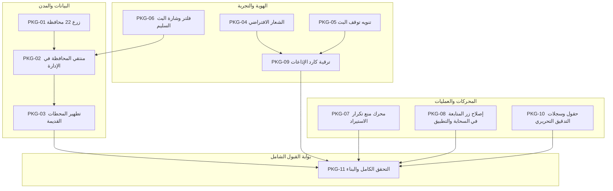

# خارطة طريق وخطة تطوير: المحافظات، البث المباشر، الهوية، الاستيراد، المتابعة، وتحديث كارد الإذاعات

تاريخ الأساس: 2026-10-20  
الحالة: خارطة طريق تنفيذية معتمدة  
المرجع التعاقدي: [Station Governorates, Stream Health, Brand Identity, and Import Deduplication Contract](../contracts/station-governorates-stream-import-contract.md)  
النطاق الفني: قاعدة بيانات Firestore، دوال Cloud Functions، لوحة الإدارة (`web_admin`)، موقع الاستماع (`web_hudhud`)، تطبيق الهاتف (`Flutter`).

---

## 1. ملخص المبادرة والأهداف الاستراتيجية

تهدف هذه الخطة إلى حل العوائق التشغيلية وتطوير التجربة البصرية وتكامل البيانات عبر 8 محاور متزامنة:
1. **جذر بيانات المدن والمحافظات**: إنهاء خطأ `"تغيّرت بيانات المدينة. أعد اختيار المدينة قبل الحفظ"` جذرياً عبر زراعة محافظات اليمن الـ 22 وإتاحة منتقي المحافظة في نموذج المحطة وتطهير البيانات التاريخية.
2. **الهوية البصرية للمحطات**: توحيد أصل تميمة الراديو الفاخرة المعتمدة (`station_placeholder.webp`) في الويب والإدارة والتطبيق كبديل رسمي عند غياب الشعار.
3. **تنويه توقف البث وإخلاء المسؤولية**: إبراز بيان شفاف للمستمع يوضح أن التوقف نابع من استوديوهات المحطة نفسها دون إخفاء المحطة أو أرشيفها.
4. **رصد وفلترة البث السليم**: توفير فلتر وشارة بصرية خضراء تفاعلية تميّز المحطات التي تعمل روابط بثها بنجاح واكتمال فحصها حديثاً.
5. **الاستيراد الذكي ومنع التكرار**: فحص التكرار داخل ملفات الإكسل ومع قاعدة البيانات لتحويل التكرارات إلى تحديثات ذكية دون إنشاء وثائق مكررة.
6. **إصلاح مسار المتابعة**: تمكين المستخدمين الموثقين بمختلف أدوارهم من متابعة المحطات وضمان إنشاء البروفايل الشخصي دون أخطاء preconditions.
7. **تحديث كارد الإذاعات**: ترقية الهيكل البصري لكارت المحطة (شبكة وقائمة) بزوايا `20px`، شريحة الموقع والتردد، وحماية كاملة من تجاوز النصوص.
8. **سجلات التدقيق وتتبع المسؤولية**: توثيق من قام بكل عملية إنشاء أو تعديل عبر حقول مدمجة ومجموعة سجلات مخصصة محمية بقواعد أمان صارمة.

---

## 2. جدول حزم العمل والبطاقات التنفيذية

| المعرف | الأولوية | الحجم | المسار | المكونات المتأثرة | معيار القبول والنجاح |
|---|:---:|:---:|---|---|---|
| **PKG-01** | P0 | M | زرع وتثبيت المحافظات اليمنية الـ 22 | `Firestore`, `tool/firebase_seed/`, `locations` | توافر كافة المحافظات الـ 22 في كلا الجذرين ببيانات موحدة ومفعلة |
| **PKG-02** | P0 | M | منتقي المدينة وتزامن بيانات الموقع | `web_admin/components/admin/content-editor.tsx` | ظهور منتقي المحافظة في نموذج المحطة وتحديث الحقول الـ 4 بنجاح |
| **PKG-03** | P0 | S–M | سكربت تطهير وتصحيح المحطات القديمة | `Node.js Migration Script`, `stations` | ربط كافة المحطات القائمة ببيانات الموقع الرسمية دون أخطاء حفظ |
| **PKG-04** | P1 | S | توحيد الشعار الافتراضي `station_placeholder.webp` | `web_admin`, `web_hudhud`, `assets` | ظهور التميمة المعتمدة تلقائياً عند غياب `logoUrl` في جميع الشاشات |
| **PKG-05** | P1 | S–M | كارت تنويه توقف البث وإخلاء المسؤولية | `StationDetailsScreen`, `web_hudhud`, ARB | ظهور بانر إخلاء المسؤولية المصدرية وزر «محاولة الاستماع» بأمان |
| **PKG-06** | P1 | S | فلتر وشارات البث السليم (Healthy Streams) | `web_admin/components/admin/admin-app.tsx` | زر فلتر `healthy` وشارة خضراء تفاعلية تفرز المحطات السليمة |
| **PKG-07** | P1 | M–L | محرك منع التكرار في الاستيراد (Deduplication) | `web_admin/lib/batch-import.ts` واختباراتها | حظر تكرار الصفوف ومطابقة البرامج والحلقات القائمة تلقائياً |
| **PKG-08** | P0 | M | إصلاح زر المتابعة وإنشاء البروفايل الذاتي | `functions/lib/station-subscriptions.js`, Flutter | متابعة المحطة تنجح للمستخدم الموثق فوراً دون رسائل خطأ |
| **PKG-09** | P1 | M | ترقية كارد الإذاعات (Station Card Luxury UI) | `lib/features/home/presentation/widgets/station_card.dart` | مظهر عصري فاخر بانحناء `20px` وشريحة تردد وحماية 200% تكبير |
| **PKG-10** | P1 | M | حقول التدقيق وسجل المسؤولية التحريرية | `save-content.ts`, `firestore.rules`, Admin UI | تسجيل `createdBy`/`updatedBy` وعرضها أسفل النماذج وسجل التدقيق |
| **PKG-11** | P0 | L | الاختبارات الشاملة ومطابقة الحزم | Flutter, Functions, Rules, Web Admin, Public Web | نجاح 100% لجميع اختبارات الوحدة والمحاكيات والبناء الإنتاجي |

---

## 3. التسلسل التنفيذي والاعتماديات (Workflow Diagram)

---

## 4. تفاصيل حزم العمل والمواصفات الفنية

### الحزمة 1: زرع وتثبيت المحافظات اليمنية (PKG-01)
- **المستندات المستهدفة**: `{root}/locations/locations/{locationId}`
- **المعايير**:
  - إنشاء وثائق المحافظات الـ 22 بمعرفات معيارية (`sanaa`, `aden`, `taiz`, `mukalla`, `seiyun`, `hudaydah`, `ibb`, `marib`, `dhamar`, `shabwah`, `al_mahrah`, `lahj`, `abyan`, `socotra`, `saadah`, `amran`, `hajjah`, `al_mahwit`, `raymah`, `al_jawf`, `al_bayda`, `al_dhalee`, `yemen`).
  - تضمين `countryCode: 'YE'`، `countryNameAr: 'اليمن'`، `sortOrder` تسلسلي، و `isActive: true`.
  - تطبيق العملية ذرياً على الجذرين `HudHudDev` و `HudHudOfficial`.

### الحزمة 2: منتقي المحافظة وتزامن بيانات الموقع (PKG-02)
- **المكونات المتأثرة**: [`web_admin/components/admin/content-editor.tsx`](../../web_admin/components/admin/content-editor.tsx)
- **المعايير**:
  - إضافة `RelationPicker` مخصص لـ `locations` داخل نموذج المحطة (`kind === 'stations'`).
  - عند اختيار المحافظة، يتم تحديث حالة النموذج وتعبئة `cityCode`, `cityNameAr`, `countryCode: 'YE'`, `countryNameAr: 'اليمن'` فوراً.
  - إيقاف الحفظ مع إبراز رسالة تحقق في حال كانت المحطة بدون مدينة صالحة.

### الحزمة 3: سكربت تطهير وتصحيح المحطات القديمة (PKG-03)
- **المسار**: `tool/migrate_station_locations.mjs`
- **المعايير**:
  - مسح كافة محطات الكتالوج القائمة في Firestore.
  - فحص ومطابقة `cityCode` و `cityNameAr` مع وثائق المحافظات المعتمدة، وتصحيح التفاوتات اللفظية والرموز القديمة.
  - تحديث المحطة بحقول الموقع الأربعة ذرياً وتحديث `adminRelationRevision` في وثيقة المدينة المرتبطة.

### الحزمة 4: توحيد الشعار الافتراضي للمحطات (PKG-04)
- **المكونات المتأثرة**:
  - `web_admin/public/images/station_placeholder.webp`
  - `web_hudhud/public/images/station_placeholder.webp`
  - [`web_admin/components/admin/station-logo.tsx`](../../web_admin/components/admin/station-logo.tsx)
  - [`web_hudhud/public-home.tsx`](../../web_hudhud/public-home.tsx)
- **المعايير**:
  - استخدام تميمة الراديو الفاخرة كخلفية افتراضية عند كون `logoUrl` فارغاً أو عند حدوث خطأ تحميل شبكي.
  - الحفاظ على زوايا دائرية متناسقة في الويب والتطبيق.

### الحزمة 5: بيان توقف البث وإخلاء المسؤولية (PKG-05)
- **المكونات المتأثرة**:
  - [`lib/features/station_details/presentation/station_details_screen.dart`](../../lib/features/station_details/presentation/station_details_screen.dart)
  - `web_hudhud/public-home.tsx`, `web_hudhud/station-detail.tsx`
  - ملفات التعريب: `lib/l10n/app_ar.arb` و `lib/l10n/app_en.arb`
- **المعايير**:
  - إبراز النص المعتمد لإخلاء المسؤولية والتوضيح أن الانقطاع من المصدر الإذاعي.
  - الحفاظ على كارت المحطة وأرشيفها وأزرار المشاركة والمفضلة وتغيير زر التشغيل إلى «محاولة الاستماع».

### الحزمة 6: فلتر وشارة البث السليم (PKG-06)
- **المكونات المتأثرة**:
  - [`web_admin/components/admin/admin-app.tsx`](../../web_admin/components/admin/admin-app.tsx)
  - [`web_admin/lib/resource-filters.ts`](../../web_admin/lib/resource-filters.ts)
- **المعايير**:
  - إضافة فلتر سريع `healthy` («بث سليم ومتاح»).
  - إبراز شارة خضراء نشطة تفاعلية (`🟢 بث سليم (أساسي / بديل)`) تعرض توقيت آخر فحص.

### الحزمة 7: محرك منع التكرار في الاستيراد (PKG-07)
- **المكونات المتأثرة**: [`web_admin/lib/batch-import.ts`](../../web_admin/lib/batch-import.ts)
- **المعايير**:
  - كشف ومنع تكرار المعرفات وعناوين البرامج والحلقات وروابط الصوت داخل الملف.
  - مطابقة البرامج القائمة بنفس `(stationId, title)` والحلقات بنفس `(programId, audioUrl)` وتحويلها لتحديث ذكي بدلاً من إنشاء مكرر.
  - توليد معرفات حتمية عبر التجزئة عند غياب المعرف.

### الحزمة 8: إصلاح زر المتابعة والاشتراكات (PKG-08)
- **المكونات المتأثرة**:
  - [`functions/lib/station-subscriptions.js`](../../functions/lib/station-subscriptions.js)
  - [`lib/features/subscriptions/data/station_subscriptions_data_source.dart`](../../lib/features/subscriptions/data/station_subscriptions_data_source.dart)
  - [`lib/features/subscriptions/presentation/station_subscriptions_controller.dart`](../../lib/features/subscriptions/presentation/station_subscriptions_controller.dart)
- **المعايير**:
  - استدعاء `ensureListenerProfile` تلقائياً في دالة السحابة إذا كان الحساب موثقاً ولكن بروفايله لم يُنشأ بعد في Firestore.
  - السماح لكافة الأدوار (`listener`, `station_admin`, `super_admin`) بالمتابعة.
  - حماية العميل باستدعاء تجهيز البروفايل قبل الحفظ.

### الحزمة 9: ترقية كارد الإذاعات (PKG-09)
- **المكونات المتأثرة**: [`lib/features/home/presentation/widgets/station_card.dart`](../../lib/features/home/presentation/widgets/station_card.dart)
- **المعايير**:
  - حواف بانحناء `20px`، إطار رفيع فاخر (`outlineVariant.withValues(alpha: 0.35)`).
  - شريحة معلومات متباينة وأنيقة للمدينة والتردد (`صنعاء · 90.9 FM`).
  - زر تشغيل رئيسي بارز وزر مفضلة نابض.
  - دعم تكبير النصوص حتى 2.0x دون حدوث Overflow.

### الحزمة 10: حقول التدقيق وسجل المسؤولية التحريرية (PKG-10)
- **المكونات المتأثرة**:
  - [`web_admin/lib/save-content.ts`](../../web_admin/lib/save-content.ts)
  - [`firestore.rules`](../../firestore.rules)
  - واجهة لوحة الإدارة (`ContentEditor`)
- **المعايير**:
  - حقن `createdBy`, `createdByName`, `createdAt` عند الإنشاء، و `updatedBy`, `updatedByName`, `updatedAt` عند التعديل.
  - كتابة سجل تدقيق في `{root}/auditLogs/auditLogs/{logId}` لكل عملية تحريرية.
  - حماية السجلات في القواعد لتقصر على الإدارة.
  - عرض معلومات المسؤول وتاريخ آخر تعديل أسفل نماذج الإدارة.

---

## 5. خطة الفحص وبوابات القبول (Acceptance Gateways)

1. **بوابة القواعد والأمان**:
   - تشغيل `npm run emulators:test` للتحقق من حماية سجلات التدقيق وسلامة حقول المحطات والمحافظات.
2. **بوابة لوحة الإدارة**:
   - تشغيل `npm run emulators:admin` للتأكد من نجاح حفظ المحطات مع المحافظات ومنع التكرار في الاستيراد.
   - التحقق من `npm run lint` و `npx tsc --noEmit` و `npm test`.
3. **بوابة دوال السحابة**:
   - تشغيل `npm test` في مجلد `functions` للتأكد من نجاح فحص المتابعة والبروفايل التلقائي.
4. **بوابة تطبيق الهاتف**:
   - تشغيل `dart format` و `flutter analyze --no-pub` و `flutter test --no-pub` لضمان خلو التعديلات البصرية في كارد الإذاعات وشاشات التفاصيل من أي أخطاء أو انكسارات.
5. **بوابة البناء النهائي**:
   - بناء `web_admin` و `web_hudhud` والتأكد من خلو مخرجات الإنتاج من أي تحذيرات أو أخطاء.
