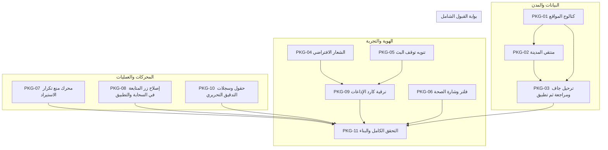

# خارطة طريق وخطة تطوير: المحافظات، البث المباشر، الهوية، الاستيراد، المتابعة، وتحديث كارد الإذاعات

تاريخ الأساس: 2026-10-20  
الحالة: نسخة مراجعة محدثة؛ بدء التنفيذ مشروط بتوحيد العقد والقرارات المبيّنة أدناه
المرجع التعاقدي: [Station Governorates, Stream Health, Brand Identity, and Import Deduplication Contract](../contracts/station-governorates-stream-import-contract.md)  
النطاق الفني: قاعدة بيانات Firestore، دوال Cloud Functions، لوحة الإدارة (`web_admin`)، موقع الاستماع (`web_hudhud`)، تطبيق الهاتف (`Flutter`).

---

## 1. ملخص المبادرة والأهداف الاستراتيجية

تهدف هذه الخطة إلى حل العوائق التشغيلية وتطوير التجربة البصرية وتكامل البيانات عبر 8 محاور مترابطة:
1. **جذر بيانات المدن والمحافظات**: إنهاء خطأ `"تغيّرت بيانات المدينة. أعد اختيار المدينة قبل الحفظ"` عبر زراعة المحافظات اليمنية الـ 22 وإتاحة منتقي المدينة في نموذج المحطة ومعالجة البيانات التاريخية وفق تقرير قابل للمراجعة.
2. **الهوية البصرية للمحطات**: توحيد أصل تميمة الراديو الفاخرة المعتمدة (`station_placeholder.webp`) في الويب والإدارة والتطبيق كبديل رسمي عند غياب الشعار.
3. **تنويه توقف البث وإخلاء المسؤولية**: إبراز بيان شفاف للمستمع يوضح أن التوقف نابع من استوديوهات المحطة نفسها دون إخفاء المحطة أو أرشيفها.
4. **رصد وفلترة البث السليم**: توفير فلتر وشارة بصرية خضراء تفاعلية تميّز المحطات التي تعمل روابط بثها بنجاح واكتمال فحصها حديثاً.
5. **الاستيراد الذكي ومنع التكرار**: فحص التكرار داخل ملفات الإكسل ومع قاعدة البيانات لتحويل التكرارات إلى تحديثات ذكية دون إنشاء وثائق مكررة.
6. **إصلاح مسار المتابعة**: تمكين المستخدمين الموثقين بمختلف أدوارهم من متابعة المحطات وضمان إنشاء البروفايل الشخصي دون أخطاء preconditions.
7. **تحديث كارد الإذاعات**: ترقية الهيكل البصري لكارت المحطة (شبكة وقائمة) بزوايا `20px`، شريحة الموقع والتردد، وحماية كاملة من تجاوز النصوص.
8. **سجلات التدقيق وتتبع المسؤولية**: توثيق من قام بكل عملية إنشاء أو تعديل عبر حقول مدمجة ومجموعة سجلات مخصصة محمية بقواعد أمان صارمة.

---

## 2. جدول حزم العمل والبطاقات التنفيذية

| المعرف | الأولوية | الحجم | المسار | المكونات المتأثرة | معيار القبول والنجاح |
|---|:---:|:---:|---|---|---|
| **PKG-01** | P0 | M | زرع المحافظات الـ 22 وموقع الإذاعات الوطنية | `Firestore`, `tool/firebase_seed/`, `locations` | 22 محافظة وموقع وطني منفصل في الجذرين، ببذرة قابلة لإعادة التشغيل وتقرير تحقق |
| **PKG-02** | P0 | M | منتقي المدينة وتزامن بيانات الموقع | `web_admin/components/admin/content-editor.tsx` | ظهور منتقي المحافظة في نموذج المحطة وتحديث الحقول الـ 4 بنجاح |
| **PKG-03** | P0 | M | ترحيل مواقع المحطات القديمة بأمان | `tool/migrate_station_locations.mjs`, `stations` | تقرير dry-run، تصنيف كل محطة، تطبيق محدود النطاق، وإثبات عدم وجود حالات غير محسومة بعد المعالجة |
| **PKG-04** | P1 | S | توحيد الشعار الافتراضي `station_placeholder.webp` | `web_admin`, `web_hudhud`, `assets` | ظهور التميمة المعتمدة تلقائياً عند غياب `logoUrl` في جميع الشاشات |
| **PKG-05** | P1 | S–M | كارت تنويه توقف البث وإخلاء المسؤولية | `StationDetailsScreen`, `web_hudhud`, ARB | ظهور بانر إخلاء المسؤولية المصدرية وزر «محاولة الاستماع» بأمان |
| **PKG-06** | P1 | S | فلتر وشارات البث السليم (Healthy Streams) | `web_admin/components/admin/admin-app.tsx` | زر فلتر `healthy` وشارة خضراء تفاعلية تفرز المحطات السليمة |
| **PKG-07** | P1 | M–L | محرك منع التكرار في الاستيراد (Deduplication) | `web_admin/lib/batch-import.ts` واختباراتها | تصنيف unchanged/update/conflict، معاينة الفروقات قبل الكتابة، ومنع الإنشاء المكرر |
| **PKG-08** | P0 | M | إصلاح زر المتابعة وإنشاء البروفايل الذاتي | `functions/lib/station-subscriptions.js`, Flutter | مسار سحابي موحد ينشئ/يتحقق من الملف الشخصي بأمان، ويقبل الحسابات المؤهلة من كل الأدوار |
| **PKG-09** | P1 | M | ترقية كارد الإذاعات (Station Card Luxury UI) | `lib/features/home/presentation/widgets/station_card.dart` | مظهر عصري فاخر بانحناء `20px` وشريحة تردد وحماية 200% تكبير |
| **PKG-10** | P1 | L | حقول التدقيق وسجل المسؤولية التحريرية | `save-content.ts`, `functions`, `firestore.rules`, Admin UI | كل تغيير تحريري مسجل ذرياً، هوية الفاعل موثقة، والسجل غير قابل للتعديل أو الحذف من العملاء |
| **PKG-11** | P0 | L | بوابات تحقق لكل حزمة وبناء التكامل | Flutter, Functions, Rules, Web Admin, Public Web | نجاح الأوامر المحددة أدناه وعدم وجود نتائج اختبار فاشلة أو حالات ترحيل/استيراد غير محسومة |

---

## 3. التسلسل التنفيذي والاعتماديات (Workflow Diagram)

---

## 4. تفاصيل حزم العمل والمواصفات الفنية

### الحزمة 1: كتالوج المحافظات والموقع الوطني (PKG-01)
- **المستندات المستهدفة**: `{root}/locations/locations/{locationId}`
- **المعايير**:
  - تثبيت 22 محافظة بالمعرفات المعيارية (`sanaa`, `aden`, `taiz`, `mukalla`, `seiyun`, `hudaydah`, `ibb`, `marib`, `dhamar`, `shabwah`, `al_mahrah`, `lahj`, `abyan`, `socotra`, `saadah`, `amran`, `hajjah`, `al_mahwit`, `raymah`, `al_jawf`, `al_bayda`, `al_dhalee`).
  - يبقى `yemen` موقعاً وطنياً مستقلاً للإذاعات العامة؛ لا يُحتسب محافظة. أضف `locationType: 'governorate' | 'national'` إلى عقد البيانات، والبذرة، والمنتقي، وعمليات التحقق قبل استخدامه. لا يُعرض كخيار محافظة محلية.
  - تتضمن كل وثيقة `countryCode: 'YE'`، `countryNameAr: 'اليمن'`، `sortOrder` ثابتاً، و `isActive: true`، إضافةً إلى `locationType`.
  - يجب أن تكون البذرة idempotent: إعادة تشغيلها لا تنشئ وثائق جديدة ولا تمسح حقولاً تحريرية غير مملوكة لها. تقارن dry-run قيم الجذرين `HudHudDev` و`HudHudOfficial` وتصدر فروقاً قبل أي كتابة.
  - لا تخلط ذرية معاملات Firestore مع اتساق الجذرين؛ اكتب الجذرين في دفعات محدودة، مع manifest يوضح نجاح/فشل كل جذر وإمكانية استئناف آمنة.

### الحزمة 2: منتقي المحافظة وتزامن بيانات الموقع (PKG-02)
- **المكونات المتأثرة**: [`web_admin/components/admin/content-editor.tsx`](../../web_admin/components/admin/content-editor.tsx)
- **المعايير**:
  - إضافة `RelationPicker` مخصص لـ `locations` داخل نموذج المحطة (`kind === 'stations'`).
  - عند اختيار المحافظة، يتم تحديث حالة النموذج وتعبئة `cityCode`, `cityNameAr`, `countryCode: 'YE'`, `countryNameAr: 'اليمن'` فوراً.
  - إضافة `locationType` للحمولة؛ السماح بالموقع الوطني فقط للمحطات الوطنية وفق حقل نطاق صريح، وإيقاف الحفظ عند غياب مرجع نشط أو عدم تطابق الحقول الأربعة مع الوثيقة المرجعية.
  - تغيير/مسح الاختيار يعيد مزامنة الحقول الأربعة في عملية حالة واحدة؛ لا تقبل قيم المدينة اليدوية كبديل عن اختيار مرجعي.
  - اختبارات نموذج وإيموليتر تثبت اختيار موقع محلي ووطني، وتمنع الحفظ دون اختيار أو مع موقع معطل أو حقول قديمة متعارضة.

### الحزمة 3: ترحيل مواقع المحطات القديمة بأمان (PKG-03)
- **المسار**: `tool/migrate_station_locations.mjs`
- **المعايير**:
  - الوضع الافتراضي `--dry-run`: يقرأ المحطات والمرجعين ويصدر JSON/CSV يبين counts، الحقول السابقة/المقترحة، سبب المطابقة، التعارضات، والمحطات التي تحتاج قراراً يدوياً. لا يكتب إلى Firestore.
  - قواعد المطابقة محافظة وحتمية: تطابق رمز مرجعي معروف أولاً، ثم اسم عربي/إنجليزي بعد Unicode NFKC وتوحيد المسافات؛ لا تحذف علامات أو كلمات مميزة. إذا اختلف الرمز والاسم أو نتج أكثر من مرشح، صنف الحالة `ambiguous` ولا تكتبها تلقائياً.
  - دعم `--root HudHudDev|HudHudOfficial` و`--apply --report <path>` صراحة؛ رفض `--apply` دون تقرير مطابق وبصمة/تاريخ بيانات التقرير، وعدم جعل `HudHudOfficial` الهدف الافتراضي.
  - قبل التطبيق، صدر نسخة احتياطية من الوثائق المستهدفة وmanifest، ثم اكتب بصفحات محدودة مع checkpoint واستئناف idempotent. لا تحذف محطة ولا تغير حقولاً خارج حقول الموقع المحددة.
  - تحديث حقول الموقع الأربعة من الوثيقة المرجعية فقط، وتحديث `adminRelationRevision` للمدن المتأثرة عند الحاجة لضمان تحديث علاقات الإدارة. إذا فشل أي batch، سجّل المعرفات والفشل وأعد تشغيل آمن.
  - القبول: dry-run مرتين على اللقطة نفسها يعطي التقرير نفسه؛ لا يوجد تعديل دون `--apply`؛ بعد التطبيق كل محطة إما مرتبطة بمرجع نشط متطابق أو موثقة كاستثناء غير مرحل، ولا يعلن اكتمال الترحيل مع استثناءات مفتوحة.

### الحزمة 4: توحيد الشعار الافتراضي للمحطات (PKG-04)
- **المكونات المتأثرة**:
  - `web_admin/public/images/station_placeholder.webp`
  - `web_hudhud/public/images/station_placeholder.webp`
  - [`web_admin/components/admin/station-logo.tsx`](../../web_admin/components/admin/station-logo.tsx)
  - [`web_hudhud/public-home.tsx`](../../web_hudhud/public-home.tsx)
- **المعايير**:
  - استخدام الأصل الافتراضي عند غياب الرابط أو كونه غير صالح أو فشل التحميل؛ إعادة محاولة الأصل الافتراضي لا تتكرر بلا نهاية، ويكون له معالج فشل نهائي ثابت.
  - وجود الأصل في المسارات العامة المحددة وفي Flutter asset manifest والتحقق من تحميله فعلياً في اختبارات المكونات.
  - الحفاظ على زوايا `18px` في Flutter و`rounded-xl` في الويب كما في العقد.

### الحزمة 5: بيان توقف البث وإخلاء المسؤولية (PKG-05)
- **المكونات المتأثرة**:
  - [`lib/features/station_details/presentation/station_details_screen.dart`](../../lib/features/station_details/presentation/station_details_screen.dart)
  - `web_hudhud/public-home.tsx`, `web_hudhud/station-detail.tsx`
  - ملفات التعريب: `lib/l10n/app_ar.arb` و `lib/l10n/app_en.arb`
- **المعايير**:
  - إبراز النص المعتمد لإخلاء المسؤولية والتوضيح أن الانقطاع من المصدر الإذاعي.
  - عرض البيان فقط عند `temporarilyStopped` أو `noOnlineSource` وفق `StationStreamHealthState`؛ الحالات المفقودة أو غير المعروفة لا تنسب العطل للمصدر، وتستخدم حالة غير متاحة محايدة.
  - إضافة النص حرفياً بالعربية وبترجمة إنجليزية معتمدة في ARB ومفاتيح الويب، مع RTL/LTR وتسميات وصول مناسبة.
  - الحفاظ على كارت المحطة وأرشيفها وأزرار المشاركة والمفضلة وتغيير زر التشغيل إلى «محاولة الاستماع»؛ تسمح المحاولة اليدوية بمحاولة واحدة لكل تفاعل، ولا تنشئ إعادة اتصال تلقائية غير محدودة.

### الحزمة 6: فلتر وشارة البث السليم (PKG-06)
- **المكونات المتأثرة**:
  - [`web_admin/components/admin/admin-app.tsx`](../../web_admin/components/admin/admin-app.tsx)
  - [`web_admin/lib/resource-filters.ts`](../../web_admin/lib/resource-filters.ts)
- **المعايير**:
  - تعريف `healthy` حصراً باجتماع `healthStatus === 'online'` و`consecutiveFailures === 0` و`lastCheckedAt` صالح لا يتجاوز عمره 45 دقيقة؛ عند الحد 45 دقيقة بالضبط يعد الفحص حديثاً، وبعده أو عند غياب/فساد التاريخ لا يعد سليماً.
  - تظهر شارة البث الأساسي/البديل وفق `streamHealthSource` فقط عند تحقق القاعدة؛ Tooltip يعرض توقيت آخر فحص محلياً من دون كشف رابط البث.
  - توضيح حالات الرصد السبع من مصدر enum الفعلي، بالنص والأيقونة واللون، مع بديل نصي لا يعتمد على اللون وحده. الفلتر يعمل على النتائج المحملة وفق بنية التصفح ولا يوحي بفحص كامل غير متاح.
  - اختبار حدود 45 دقيقة، البيانات الناقصة، الفشل المتتابع، والمصدر الأساسي والبديل.

### الحزمة 7: محرك منع التكرار في الاستيراد (PKG-07)
- **المكونات المتأثرة**: [`web_admin/lib/batch-import.ts`](../../web_admin/lib/batch-import.ts)
- **المعايير**:
  - تطبيع العناوين بـ Unicode NFKC، trim، دمج المسافات المتتابعة، وتحويل الأحرف اللاتينية لحالة موحدة؛ لا تحذف علامات الترقيم أو الكلمات العربية. تكرار معرف صريح داخل الورقة خطأ للصف اللاحق مع رقم الصف.
  - البرامج داخل الملف تُفحص وفق `(stationId, normalizedTitle)`؛ الحلقات داخله تُرفض عند تكرار `(programId, normalizedAudioUrl)` أو `(programId, normalizedTitle)` لتفادي الالتباس.
  - تطبيع URL للحلقة بتحليل URL وخفض حالة المضيف وإزالة fragment فقط؛ يحافظ على path وquery لأن query قد يحمل صلاحية أو هوية مورد. لا تستخدم العنوان وحده لمطابقة حلقة قائمة.
  - مطابقة البرامج القائمة وفق `(stationId, normalizedTitle)` والحلقات وفق `(programId, normalizedAudioUrl)`. تطابق واحد يساوي المحتوى يصنف `unchanged`؛ اختلافه يصنف `update` مع diff واختيار صريح قبل الكتابة. أكثر من تطابق يصنف `conflict` ولا يكتب تلقائياً.
  - شاشة المعاينة تعرض create/update/unchanged/invalid/conflict، حقول diff، عدد السجلات المتأثرة، وتطلب تأكيداً قبل تطبيق update. لا تستبدل حقولاً غير موجودة في الملف ولا تكتب الحقول الفارغة فوق بيانات قائمة إلا بخيار مسح صريح.
  - معرّف الحلقة الحتمي هو 64 حرف hex من SHA-256 لـ `programId + '\n' + normalizedAudioUrl`. عند غياب معرف البرنامج، استخدم 64 حرف hex من SHA-256 لـ `stationId + '\n' + normalizedTitle`. عند تعارض ID حتمي مع مستند مختلف، أوقف الصف كـ conflict.
  - تجنب سباق الاستيرادات المتزامنة عبر مستندات هوية حتمية في `{root}/importKeys/importKeys/{keyHash}`؛ اقرأ/احجز المفتاح داخل معاملة الكتابة قبل إنشاء/تحديث الهدف، وابنِ المفاتيح للمحتوى القديم أو اكتشف التكرارات القديمة قبل السماح بالكتابة. تعارض المفتاح يوقف الصف كـ conflict. اختبر استيرادين متزامنين للمفتاح نفسه.
  - حدّث العقد المشار إليه في أعلى الوثيقة ليطابق اختيار المفاتيح هذا قبل التنفيذ، خصوصاً قاعدة عنوان الحلقة داخل الملف مقابل مطابقة قاعدة البيانات.

### الحزمة 8: إصلاح زر المتابعة والاشتراكات (PKG-08)
- **المكونات المتأثرة**:
  - [`functions/lib/station-subscriptions.js`](../../functions/lib/station-subscriptions.js)
  - [`lib/features/subscriptions/data/station_subscriptions_data_source.dart`](../../lib/features/subscriptions/data/station_subscriptions_data_source.dart)
  - [`lib/features/subscriptions/presentation/station_subscriptions_controller.dart`](../../lib/features/subscriptions/presentation/station_subscriptions_controller.dart)
- **المعايير**:
  - اجعل callable `setStationSubscription` المسار المرجعي الوحيد لإنشاء/استعادة ملف المتابع ثم تسجيل الاشتراك داخل معاملة واحدة؛ لا يكتب العميل وثيقة profile مباشرة. استخدم `ensureListenerProfile` القائم إن كان يطابق هذا العقد.
  - تعريف الأهلية: Firebase Auth موثق البريد وحساب نشط، مع السماح بأدوار `listener`, `station_admin`, `super_admin`؛ الدور يغير الصلاحيات الإدارية ولا يمنع الاشتراك. الحساب غير الموثق/المعطل يرفض برسالة مستقرة ولا ينشأ له profile.
  - إنشاء الملف idempotent، الحفاظ على الحقول الشخصية الموجودة، وعدم تحويل ملف محذوف/محظور أو غير نشط إلى ملف نشط دون قاعدة واضحة. التحقق من المحطة النشطة قبل تسجيل متابعة مفعلة.
  - Flutter يستدعي callable فقط، يعرض حالة تحميل/نجاح/خطأ قابلة لإعادة المحاولة، ولا ينفذ تجهيزاً مزدوجاً محلياً. اختبر التزامن، profile مفقود، الأدوار الثلاثة، حساباً غير موثق، محطة غير نشطة، وإعادة الطلب.

### الحزمة 9: ترقية كارد الإذاعات (PKG-09)
- **المكونات المتأثرة**: [`lib/features/home/presentation/widgets/station_card.dart`](../../lib/features/home/presentation/widgets/station_card.dart)
- **المعايير**:
  - حواف بانحناء `20px`، إطار رفيع فاخر (`outlineVariant.withValues(alpha: 0.35)`).
  - شريحة معلومات متباينة وأنيقة للمدينة والتردد (`صنعاء · 90.9 FM`).
  - زر تشغيل رئيسي بارز؛ حركة المفضلة خفيفة وتحترم `MediaQuery.disableAnimations`/تقليل الحركة.
  - اختبار grid وlist، RTL/LTR، الوضع الفاتح/الداكن، أسماء طويلة، وحقول موقع/تردد مفقودة عند textScaler 1.0 و2.0؛ القبول بلا overflow أو قص معلومات تفاعلية، مع semantics للأزرار.

### الحزمة 10: حقول التدقيق وسجل المسؤولية التحريرية (PKG-10)
- **المكونات المتأثرة**:
  - [`web_admin/lib/save-content.ts`](../../web_admin/lib/save-content.ts)
  - [`firestore.rules`](../../firestore.rules)
  - واجهة لوحة الإدارة (`ContentEditor`)
- **المعايير**:
  - اجعل عملية الحفظ الإدارية callable موحداً يتحقق من الهوية والدور ويكتب المحتوى وحقول التدقيق وسجل التدقيق في معاملة Admin Firestore واحدة؛ لا تكتب actor أو audit من متصفح العميل مباشرة. إذا تعذر إدخال callable ضمن هذه الشريحة، أوقف PKG-10 وحدّث التصميم قبل التنفيذ بدلاً من ادعاء ذرية لا تفرضها القواعد.
  - حقول الإنشاء: `createdBy` من UID الموثق، `createdByName` من claim/ملف موثوق أو البريد المعتمد، `createdAt` من توقيت الخادم؛ التحديث يغير `updatedBy`, `updatedByName`, `updatedAt` ويحافظ على حقول الإنشاء.
  - سجل append-only لكل create/update/delete/import مع `targetKind`, `targetId`, `action`, `actorUid`, `actorEmail` الموثق، `timestamp` خادمي، وملخص محدود لا يحتوي بيانات حساسة أو روابط بث. عمليات الاستيراد تسجل لكل هدف أو تسجل دفعة مع عناصر أهداف قابلة للتدقيق.
  - لا يسمح للعميل بإنشاء/تعديل/حذف السجلات. القراءة لمدير مخول فقط، مع قواعد/اختبارات تثبت المنع للضيف والمستمع ومدير المحطة إن لم يكن ضمن الدور المخول. عرّف مدة الاحتفاظ والتصدير قبل إطلاق الإنتاج.
  - اختبر ذرية الفشل: عند رفض/فشل كتابة audit لا يتغير المحتوى، والعكس صحيح؛ اختبر حفظ حقول الإنشاء، هوية actor، منع العبث بالسجل، والحذف والاستيراد.
  - تعرض الواجهة بيانات الفاعل والتوقيت للحقول الموجودة فقط، مع حالة واضحة للسجلات القديمة التي لا تحتوي بيانات تدقيق.

---

## 5. خطة الفحص وبوابات القبول (Acceptance Gateways)

1. **قبل التنفيذ — عقد ومخطط البيانات**:
   - حدّث `docs/contracts/station-governorates-stream-import-contract.md` ليعتمد `locationType`، قواعد مطابقة الاستيراد، أهلية الحساب، وحدود التدقيق أعلاه. لا يبدأ التنفيذ قبل اتساق الخطة والعقد.
   - سجّل baseline للأوامر قبل التغيير، وميّز الفشل السابق عن regression جديد.
2. **بوابة كل حزمة**:
   - كل PKG يملك اختبارات الوحدة المناسبة واختبارات تكامل/إيموليتر عندما يعبر Firestore/Auth/UI؛ لا تُجمع كل الحالات في بوابة ختامية فقط.
   - بيانات emulator اصطناعية فقط. migration على emulator أولاً، ثم dry-run على كل root؛ أي تشغيل إنتاجي خارج نطاق هذه الخطة ويتطلب مسار إصدار/تفويض مستقل.
3. **بوابة القواعد والإدارة** من مجلد `hudhud_fm`:
   - `npm run emulators:test`، و`npm run emulators:admin`، و`npm --prefix web_admin test`، و`npm --prefix web_admin run lint`، و`cd web_admin && npx tsc --noEmit`.
   - `npm --prefix web_admin run build` لإثبات بناء الإدارة.
4. **بوابة Cloud Functions والاشتراكات**:
   - `npm --prefix functions test` و`npm --prefix functions run lint`، و`npm run emulators:subscriptions`؛ أضف اختبار callable للاشتراك وتهيئة الملف للحالات المحددة في PKG-08 وPKG-10.
5. **بوابة الموقع العام**:
   - `npm --prefix web_hudhud test`، `npm --prefix web_hudhud run lint`، و`npm --prefix web_hudhud run build` (يتضمن typecheck وفق scripts الحالية).
6. **بوابة Flutter**:
   - من `hudhud_fm`: `dart format --output=none --set-exit-if-changed lib test`، `flutter analyze --no-pub`، `flutter test --no-pub`. اختبر حالات التفاصيل والكارد وtextScaler 1.0/2.0 في الاختبارات المسماة في مصفوفة العقد.
7. **بوابة الترحيل والاستيراد**:
   - تحقق من dry-run المتكرر، عدم الكتابة دون `--apply`، resume بعد batch فاشل، وسلامة root المستهدف. لا تُغلق PKG-03 مع سجلات ambiguous غير محلولة.
   - تحقق من إعادة الاستيراد unchanged، update مع diff، تعارضات متعددة، تكرار داخل الملف، وسباق محاولتي استيراد.
8. **بوابة التكامل**:
   - أعد جميع الأوامر المتأثرة بعد دمج الحزم. النجاح يعني exit code صفر لكل أمر، وعدم وجود اختبار متجاهل/فاشل جديد، ونجاح builds الثلاثة؛ لا تستخدم نسبة عامة مثل “100%”. سجّل الأوامر والنتائج والقيود في PR.
